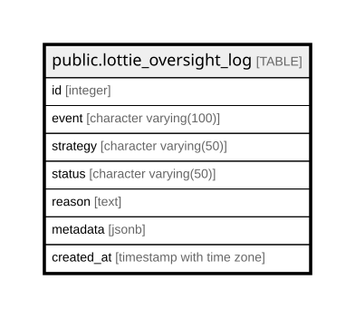

# public.lottie_oversight_log

## Columns

| Name | Type | Default | Nullable | Children | Parents | Comment |
| ---- | ---- | ------- | -------- | -------- | ------- | ------- |
| id | integer | nextval('lottie_oversight_log_id_seq'::regclass) | false |  |  |  |
| event | character varying(100) |  | false |  |  |  |
| strategy | character varying(50) |  | true |  |  |  |
| status | character varying(50) |  | false |  |  |  |
| reason | text |  | true |  |  |  |
| metadata | jsonb |  | true |  |  |  |
| created_at | timestamp with time zone | now() | false |  |  |  |

## Viewpoints

| Name | Definition |
| ---- | ---------- |
| [public schema](viewpoint-schema-public.md) | All mapped relations in public. |

## Constraints

| Name | Type | Definition |
| ---- | ---- | ---------- |
| lottie_oversight_log_pkey | PRIMARY KEY | PRIMARY KEY (id) |

## Indexes

| Name | Definition |
| ---- | ---------- |
| lottie_oversight_log_created_at_idx | CREATE INDEX lottie_oversight_log_created_at_idx ON public.lottie_oversight_log USING btree (created_at) |
| lottie_oversight_log_event_idx | CREATE INDEX lottie_oversight_log_event_idx ON public.lottie_oversight_log USING btree (event) |
| lottie_oversight_log_pkey | CREATE UNIQUE INDEX lottie_oversight_log_pkey ON public.lottie_oversight_log USING btree (id) |
| lottie_oversight_log_strategy_idx | CREATE INDEX lottie_oversight_log_strategy_idx ON public.lottie_oversight_log USING btree (strategy) |

## Relations

---

> Generated by [tbls](https://github.com/k1LoW/tbls)
