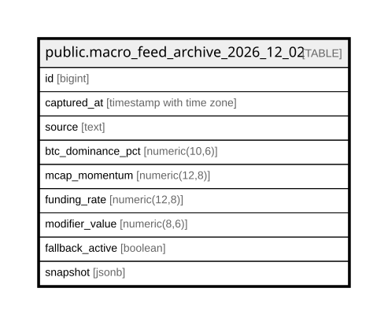

# public.macro_feed_archive_2026_12_02

## Columns

| Name | Type | Default | Nullable | Children | Parents | Comment |
| ---- | ---- | ------- | -------- | -------- | ------- | ------- |
| id | bigint | nextval('macro_feed_archive_id_seq'::regclass) | false |  |  |  |
| captured_at | timestamp with time zone | now() | false |  |  |  |
| source | text |  | false |  |  |  |
| btc_dominance_pct | numeric(10,6) |  | true |  |  |  |
| mcap_momentum | numeric(12,8) |  | true |  |  |  |
| funding_rate | numeric(12,8) |  | true |  |  |  |
| modifier_value | numeric(8,6) |  | true |  |  |  |
| fallback_active | boolean | false | false |  |  |  |
| snapshot | jsonb | '{"schema_version": 1}'::jsonb | false |  |  |  |

## Viewpoints

| Name | Definition |
| ---- | ---------- |
| [public schema](viewpoint-schema-public.md) | All mapped relations in public. |

## Constraints

| Name | Type | Definition |
| ---- | ---- | ---------- |
| macro_feed_archive_2026_12_02_pkey | PRIMARY KEY | PRIMARY KEY (captured_at, source, id) |

## Indexes

| Name | Definition |
| ---- | ---------- |
| macro_feed_archive_2026_12_02_pkey | CREATE UNIQUE INDEX macro_feed_archive_2026_12_02_pkey ON public.macro_feed_archive_2026_12_02 USING btree (captured_at, source, id) |
| macro_feed_archive_2026_12_02_source_captured_at_idx | CREATE INDEX macro_feed_archive_2026_12_02_source_captured_at_idx ON public.macro_feed_archive_2026_12_02 USING btree (source, captured_at DESC) |

## Relations

---

> Generated by [tbls](https://github.com/k1LoW/tbls)
