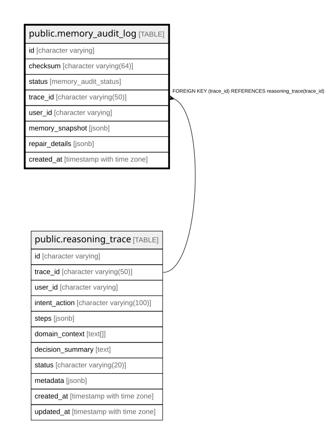

# public.memory_audit_log

## Columns

| Name | Type | Default | Nullable | Children | Parents | Comment |
| ---- | ---- | ------- | -------- | -------- | ------- | ------- |
| id | character varying | gen_random_uuid() | false |  |  |  |
| checksum | character varying(64) |  | false |  |  |  |
| status | memory_audit_status | 'VERIFIED'::memory_audit_status | false |  |  |  |
| trace_id | character varying(50) |  | true |  | [public.reasoning_trace](public.reasoning_trace.md) |  |
| user_id | character varying |  | true |  |  |  |
| memory_snapshot | jsonb |  | true |  |  |  |
| repair_details | jsonb |  | true |  |  |  |
| created_at | timestamp with time zone | now() | false |  |  |  |

## Viewpoints

| Name | Definition |
| ---- | ---------- |
| [public schema](viewpoint-schema-public.md) | All mapped relations in public. |

## Constraints

| Name | Type | Definition |
| ---- | ---- | ---------- |
| memory_audit_log_pkey | PRIMARY KEY | PRIMARY KEY (id) |
| memory_audit_log_trace_id_reasoning_trace_trace_id_fk | FOREIGN KEY | FOREIGN KEY (trace_id) REFERENCES reasoning_trace(trace_id) |

## Indexes

| Name | Definition |
| ---- | ---------- |
| memory_audit_log_checksum_idx | CREATE INDEX memory_audit_log_checksum_idx ON public.memory_audit_log USING btree (checksum) |
| memory_audit_log_created_at_idx | CREATE INDEX memory_audit_log_created_at_idx ON public.memory_audit_log USING btree (created_at) |
| memory_audit_log_pkey | CREATE UNIQUE INDEX memory_audit_log_pkey ON public.memory_audit_log USING btree (id) |
| memory_audit_log_status_idx | CREATE INDEX memory_audit_log_status_idx ON public.memory_audit_log USING btree (status) |
| memory_audit_log_trace_id_idx | CREATE INDEX memory_audit_log_trace_id_idx ON public.memory_audit_log USING btree (trace_id) |
| memory_audit_log_user_id_idx | CREATE INDEX memory_audit_log_user_id_idx ON public.memory_audit_log USING btree (user_id) |

## Relations

---

> Generated by [tbls](https://github.com/k1LoW/tbls)
