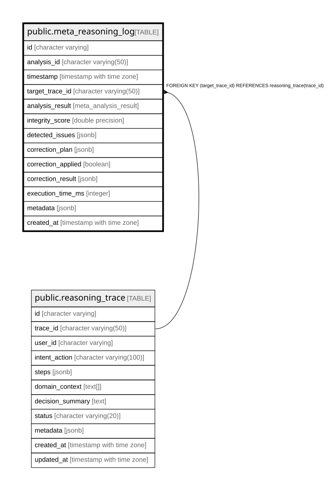

# public.meta_reasoning_log

## Columns

| Name | Type | Default | Nullable | Children | Parents | Comment |
| ---- | ---- | ------- | -------- | -------- | ------- | ------- |
| id | character varying | gen_random_uuid() | false |  |  |  |
| analysis_id | character varying(50) |  | false |  |  |  |
| timestamp | timestamp with time zone | now() | false |  |  |  |
| target_trace_id | character varying(50) |  | false |  | [public.reasoning_trace](public.reasoning_trace.md) |  |
| analysis_result | meta_analysis_result |  | false |  |  |  |
| integrity_score | double precision |  | true |  |  |  |
| detected_issues | jsonb |  | true |  |  |  |
| correction_plan | jsonb |  | true |  |  |  |
| correction_applied | boolean | false | true |  |  |  |
| correction_result | jsonb |  | true |  |  |  |
| execution_time_ms | integer |  | true |  |  |  |
| metadata | jsonb |  | true |  |  |  |
| created_at | timestamp with time zone | now() | false |  |  |  |

## Viewpoints

| Name | Definition |
| ---- | ---------- |
| [public schema](viewpoint-schema-public.md) | All mapped relations in public. |

## Constraints

| Name | Type | Definition |
| ---- | ---- | ---------- |
| meta_reasoning_log_analysis_id_unique | UNIQUE | UNIQUE (analysis_id) |
| meta_reasoning_log_pkey | PRIMARY KEY | PRIMARY KEY (id) |
| meta_reasoning_log_target_trace_id_reasoning_trace_trace_id_fk | FOREIGN KEY | FOREIGN KEY (target_trace_id) REFERENCES reasoning_trace(trace_id) |

## Indexes

| Name | Definition |
| ---- | ---------- |
| meta_reasoning_log_analysis_id_idx | CREATE INDEX meta_reasoning_log_analysis_id_idx ON public.meta_reasoning_log USING btree (analysis_id) |
| meta_reasoning_log_analysis_id_unique | CREATE UNIQUE INDEX meta_reasoning_log_analysis_id_unique ON public.meta_reasoning_log USING btree (analysis_id) |
| meta_reasoning_log_analysis_result_idx | CREATE INDEX meta_reasoning_log_analysis_result_idx ON public.meta_reasoning_log USING btree (analysis_result) |
| meta_reasoning_log_created_at_idx | CREATE INDEX meta_reasoning_log_created_at_idx ON public.meta_reasoning_log USING btree (created_at) |
| meta_reasoning_log_pkey | CREATE UNIQUE INDEX meta_reasoning_log_pkey ON public.meta_reasoning_log USING btree (id) |
| meta_reasoning_log_target_trace_id_idx | CREATE INDEX meta_reasoning_log_target_trace_id_idx ON public.meta_reasoning_log USING btree (target_trace_id) |

## Relations

---

> Generated by [tbls](https://github.com/k1LoW/tbls)
