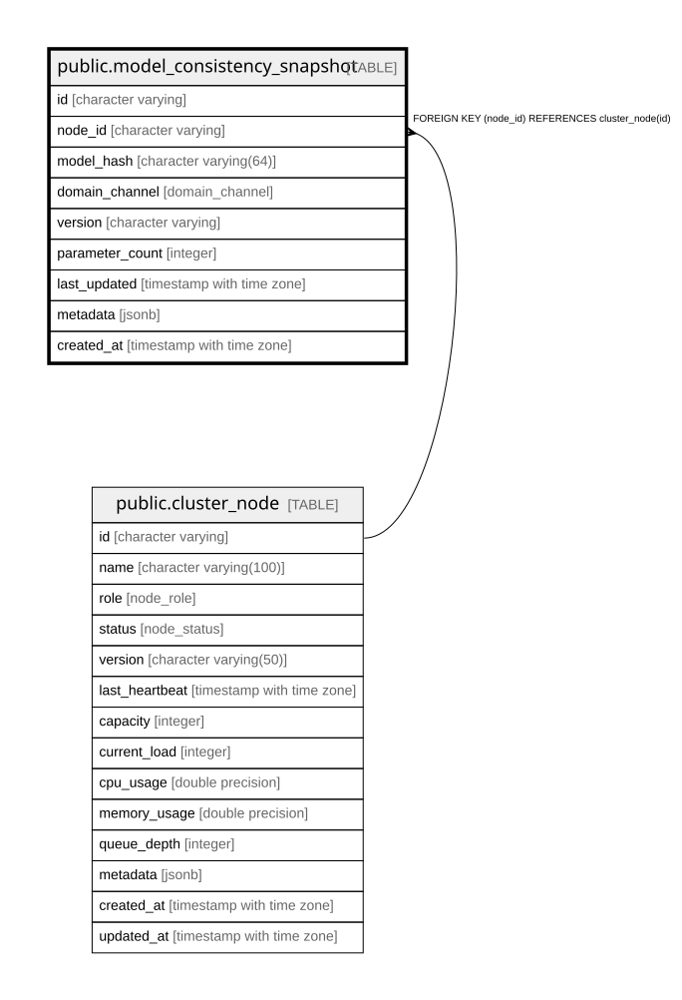

# public.model_consistency_snapshot

## Columns

| Name | Type | Default | Nullable | Children | Parents | Comment |
| ---- | ---- | ------- | -------- | -------- | ------- | ------- |
| id | character varying | gen_random_uuid() | false |  |  |  |
| node_id | character varying |  | false |  | [public.cluster_node](public.cluster_node.md) |  |
| model_hash | character varying(64) |  | false |  |  |  |
| domain_channel | domain_channel |  | false |  |  |  |
| version | character varying |  | false |  |  |  |
| parameter_count | integer | 0 | false |  |  |  |
| last_updated | timestamp with time zone |  | false |  |  |  |
| metadata | jsonb |  | true |  |  |  |
| created_at | timestamp with time zone | now() | false |  |  |  |

## Viewpoints

| Name | Definition |
| ---- | ---------- |
| [public schema](viewpoint-schema-public.md) | All mapped relations in public. |

## Constraints

| Name | Type | Definition |
| ---- | ---- | ---------- |
| model_consistency_snapshot_node_id_fkey | FOREIGN KEY | FOREIGN KEY (node_id) REFERENCES cluster_node(id) |
| model_consistency_snapshot_pkey | PRIMARY KEY | PRIMARY KEY (id) |

## Indexes

| Name | Definition |
| ---- | ---------- |
| model_consistency_snapshot_created_at_idx | CREATE INDEX model_consistency_snapshot_created_at_idx ON public.model_consistency_snapshot USING btree (created_at) |
| model_consistency_snapshot_domain_channel_idx | CREATE INDEX model_consistency_snapshot_domain_channel_idx ON public.model_consistency_snapshot USING btree (domain_channel) |
| model_consistency_snapshot_model_hash_idx | CREATE INDEX model_consistency_snapshot_model_hash_idx ON public.model_consistency_snapshot USING btree (model_hash) |
| model_consistency_snapshot_node_id_idx | CREATE INDEX model_consistency_snapshot_node_id_idx ON public.model_consistency_snapshot USING btree (node_id) |
| model_consistency_snapshot_pkey | CREATE UNIQUE INDEX model_consistency_snapshot_pkey ON public.model_consistency_snapshot USING btree (id) |

## Relations

---

> Generated by [tbls](https://github.com/k1LoW/tbls)
