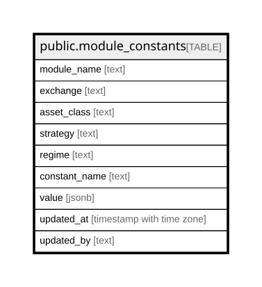

# public.module_constants

## Description

Module-level constants registry. Live as of B75: data_archive (B70 archive sweep retention), data_lifecycle (B75 tiered storage retention + bucket config), database_monitor (B75 alarm thresholds against Supabase Pro plan cap). NOTE: data_archive.b70_postgres_retention_days is to-be-deprecated by B75.x in favor of per-table data_lifecycle.<table>.hot_retention_days.

## Columns

| Name | Type | Default | Nullable | Children | Parents | Comment |
| ---- | ---- | ------- | -------- | -------- | ------- | ------- |
| module_name | text |  | false |  |  |  |
| exchange | text | '*'::text | false |  |  |  |
| asset_class | text | '*'::text | false |  |  |  |
| strategy | text | '*'::text | false |  |  |  |
| regime | text | '*'::text | false |  |  |  |
| constant_name | text |  | false |  |  |  |
| value | jsonb |  | false |  |  |  |
| updated_at | timestamp with time zone | now() | false |  |  |  |
| updated_by | text |  | true |  |  |  |

## Viewpoints

| Name | Definition |
| ---- | ---------- |
| [public schema](viewpoint-schema-public.md) | All mapped relations in public. |

## Constraints

| Name | Type | Definition |
| ---- | ---- | ---------- |
| module_constants_pkey | PRIMARY KEY | PRIMARY KEY (module_name, exchange, asset_class, strategy, regime, constant_name) |

## Indexes

| Name | Definition |
| ---- | ---------- |
| idx_module_constants_exchange_asset | CREATE INDEX idx_module_constants_exchange_asset ON public.module_constants USING btree (exchange, asset_class) |
| module_constants_pkey | CREATE UNIQUE INDEX module_constants_pkey ON public.module_constants USING btree (module_name, exchange, asset_class, strategy, regime, constant_name) |

## Relations

---

> Generated by [tbls](https://github.com/k1LoW/tbls)
