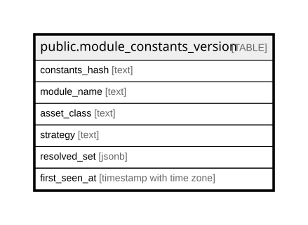

# public.module_constants_version

## Columns

| Name | Type | Default | Nullable | Children | Parents | Comment |
| ---- | ---- | ------- | -------- | -------- | ------- | ------- |
| constants_hash | text |  | false |  |  |  |
| module_name | text |  | false |  |  |  |
| asset_class | text |  | false |  |  |  |
| strategy | text |  | false |  |  |  |
| resolved_set | jsonb |  | false |  |  |  |
| first_seen_at | timestamp with time zone | now() | false |  |  |  |

## Viewpoints

| Name | Definition |
| ---- | ---------- |
| [public schema](viewpoint-schema-public.md) | All mapped relations in public. |

## Constraints

| Name | Type | Definition |
| ---- | ---- | ---------- |
| module_constants_version_pkey | PRIMARY KEY | PRIMARY KEY (constants_hash) |

## Indexes

| Name | Definition |
| ---- | ---------- |
| module_constants_version_pkey | CREATE UNIQUE INDEX module_constants_version_pkey ON public.module_constants_version USING btree (constants_hash) |
| module_constants_version_strat | CREATE INDEX module_constants_version_strat ON public.module_constants_version USING btree (strategy, asset_class) |

## Relations

---

> Generated by [tbls](https://github.com/k1LoW/tbls)
