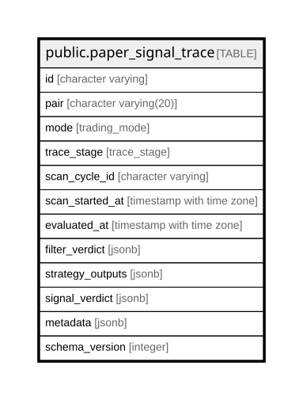

# public.paper_signal_trace

## Columns

| Name | Type | Default | Nullable | Children | Parents | Comment |
| ---- | ---- | ------- | -------- | -------- | ------- | ------- |
| id | character varying | gen_random_uuid() | false |  |  |  |
| pair | character varying(20) |  | false |  |  |  |
| mode | trading_mode | 'paper'::trading_mode | false |  |  |  |
| trace_stage | trace_stage |  | false |  |  |  |
| scan_cycle_id | character varying |  | true |  |  |  |
| scan_started_at | timestamp with time zone |  | true |  |  |  |
| evaluated_at | timestamp with time zone | now() | true |  |  |  |
| filter_verdict | jsonb |  | true |  |  |  |
| strategy_outputs | jsonb |  | true |  |  |  |
| signal_verdict | jsonb |  | true |  |  |  |
| metadata | jsonb |  | true |  |  |  |
| schema_version | integer | 1 | true |  |  |  |

## Viewpoints

| Name | Definition |
| ---- | ---------- |
| [public schema](viewpoint-schema-public.md) | All mapped relations in public. |

## Constraints

| Name | Type | Definition |
| ---- | ---- | ---------- |
| paper_signal_trace_pkey | PRIMARY KEY | PRIMARY KEY (id) |

## Indexes

| Name | Definition |
| ---- | ---------- |
| paper_signal_trace_pkey | CREATE UNIQUE INDEX paper_signal_trace_pkey ON public.paper_signal_trace USING btree (id) |
| signal_trace_mode_evaluated_idx | CREATE INDEX signal_trace_mode_evaluated_idx ON public.paper_signal_trace USING btree (mode, evaluated_at DESC) |
| signal_trace_mode_pair_evaluated_idx | CREATE INDEX signal_trace_mode_pair_evaluated_idx ON public.paper_signal_trace USING btree (mode, pair, evaluated_at DESC) |
| signal_trace_mode_stage_idx | CREATE INDEX signal_trace_mode_stage_idx ON public.paper_signal_trace USING btree (mode, trace_stage) WHERE (trace_stage = 'signal'::trace_stage) |

## Relations

---

> Generated by [tbls](https://github.com/k1LoW/tbls)
