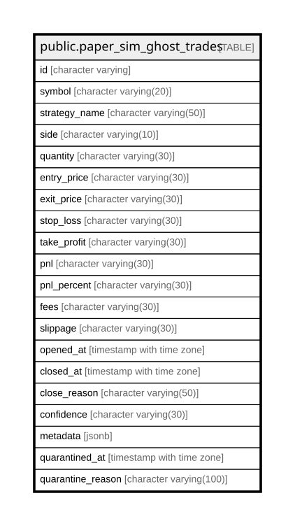

# public.paper_sim_ghost_trades

## Columns

| Name | Type | Default | Nullable | Children | Parents | Comment |
| ---- | ---- | ------- | -------- | -------- | ------- | ------- |
| id | character varying |  | false |  |  |  |
| symbol | character varying(20) |  | false |  |  |  |
| strategy_name | character varying(50) |  | true |  |  |  |
| side | character varying(10) |  | true |  |  |  |
| quantity | character varying(30) |  | true |  |  |  |
| entry_price | character varying(30) |  | true |  |  |  |
| exit_price | character varying(30) |  | true |  |  |  |
| stop_loss | character varying(30) |  | true |  |  |  |
| take_profit | character varying(30) |  | true |  |  |  |
| pnl | character varying(30) |  | true |  |  |  |
| pnl_percent | character varying(30) |  | true |  |  |  |
| fees | character varying(30) |  | true |  |  |  |
| slippage | character varying(30) |  | true |  |  |  |
| opened_at | timestamp with time zone |  | true |  |  |  |
| closed_at | timestamp with time zone |  | true |  |  |  |
| close_reason | character varying(50) |  | true |  |  |  |
| confidence | character varying(30) |  | true |  |  |  |
| metadata | jsonb |  | true |  |  |  |
| quarantined_at | timestamp with time zone | now() | true |  |  |  |
| quarantine_reason | character varying(100) |  | true |  |  |  |

## Viewpoints

| Name | Definition |
| ---- | ---------- |
| [public schema](viewpoint-schema-public.md) | All mapped relations in public. |

## Constraints

| Name | Type | Definition |
| ---- | ---- | ---------- |
| paper_sim_ghost_trades_pkey | PRIMARY KEY | PRIMARY KEY (id) |

## Indexes

| Name | Definition |
| ---- | ---------- |
| paper_sim_ghost_trades_pkey | CREATE UNIQUE INDEX paper_sim_ghost_trades_pkey ON public.paper_sim_ghost_trades USING btree (id) |

## Relations

---

> Generated by [tbls](https://github.com/k1LoW/tbls)
