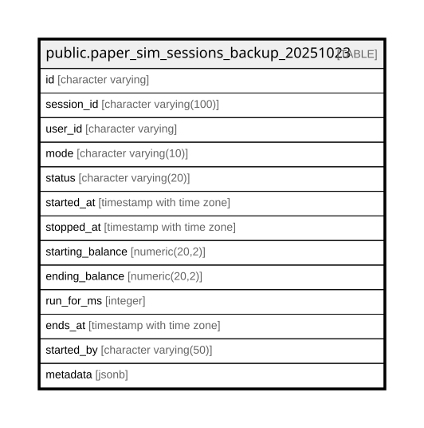

# public.paper_sim_sessions_backup_20251023

## Columns

| Name | Type | Default | Nullable | Children | Parents | Comment |
| ---- | ---- | ------- | -------- | -------- | ------- | ------- |
| id | character varying | gen_random_uuid() | false |  |  |  |
| session_id | character varying(100) |  | false |  |  |  |
| user_id | character varying |  | false |  |  |  |
| mode | character varying(10) | 'paper'::character varying | false |  |  |  |
| status | character varying(20) |  | false |  |  |  |
| started_at | timestamp with time zone | now() | false |  |  |  |
| stopped_at | timestamp with time zone |  | true |  |  |  |
| starting_balance | numeric(20,2) | 10000 | true |  |  |  |
| ending_balance | numeric(20,2) |  | true |  |  |  |
| run_for_ms | integer |  | true |  |  |  |
| ends_at | timestamp with time zone |  | true |  |  |  |
| started_by | character varying(50) | 'manual'::character varying | true |  |  |  |
| metadata | jsonb |  | true |  |  |  |

## Viewpoints

| Name | Definition |
| ---- | ---------- |
| [public schema](viewpoint-schema-public.md) | All mapped relations in public. |

## Constraints

| Name | Type | Definition |
| ---- | ---- | ---------- |
| paper_sim_sessions_backup_20251023_pkey | PRIMARY KEY | PRIMARY KEY (id) |
| paper_sim_sessions_backup_20251023_session_id_key | UNIQUE | UNIQUE (session_id) |

## Indexes

| Name | Definition |
| ---- | ---------- |
| paper_sim_sessions_backup_20251023_pkey | CREATE UNIQUE INDEX paper_sim_sessions_backup_20251023_pkey ON public.paper_sim_sessions_backup_20251023 USING btree (id) |
| paper_sim_sessions_backup_20251023_session_id_idx | CREATE UNIQUE INDEX paper_sim_sessions_backup_20251023_session_id_idx ON public.paper_sim_sessions_backup_20251023 USING btree (session_id) |
| paper_sim_sessions_backup_20251023_session_id_key | CREATE UNIQUE INDEX paper_sim_sessions_backup_20251023_session_id_key ON public.paper_sim_sessions_backup_20251023 USING btree (session_id) |
| paper_sim_sessions_backup_20251023_started_at_idx | CREATE INDEX paper_sim_sessions_backup_20251023_started_at_idx ON public.paper_sim_sessions_backup_20251023 USING btree (started_at) |
| paper_sim_sessions_backup_20251023_status_idx | CREATE INDEX paper_sim_sessions_backup_20251023_status_idx ON public.paper_sim_sessions_backup_20251023 USING btree (status) |
| paper_sim_sessions_backup_20251023_user_id_idx | CREATE INDEX paper_sim_sessions_backup_20251023_user_id_idx ON public.paper_sim_sessions_backup_20251023 USING btree (user_id) |

## Relations

---

> Generated by [tbls](https://github.com/k1LoW/tbls)
