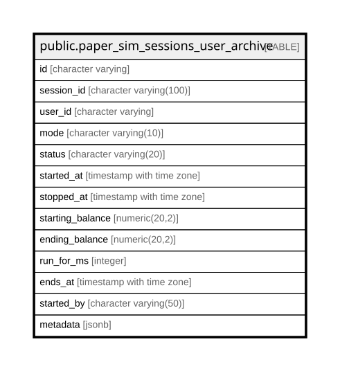

# public.paper_sim_sessions_user_archive

## Columns

| Name | Type | Default | Nullable | Children | Parents | Comment |
| ---- | ---- | ------- | -------- | -------- | ------- | ------- |
| id | character varying |  | true |  |  |  |
| session_id | character varying(100) |  | true |  |  |  |
| user_id | character varying |  | true |  |  |  |
| mode | character varying(10) |  | true |  |  |  |
| status | character varying(20) |  | true |  |  |  |
| started_at | timestamp with time zone |  | true |  |  |  |
| stopped_at | timestamp with time zone |  | true |  |  |  |
| starting_balance | numeric(20,2) |  | true |  |  |  |
| ending_balance | numeric(20,2) |  | true |  |  |  |
| run_for_ms | integer |  | true |  |  |  |
| ends_at | timestamp with time zone |  | true |  |  |  |
| started_by | character varying(50) |  | true |  |  |  |
| metadata | jsonb |  | true |  |  |  |

## Viewpoints

| Name | Definition |
| ---- | ---------- |
| [public schema](viewpoint-schema-public.md) | All mapped relations in public. |

## Relations

---

> Generated by [tbls](https://github.com/k1LoW/tbls)
