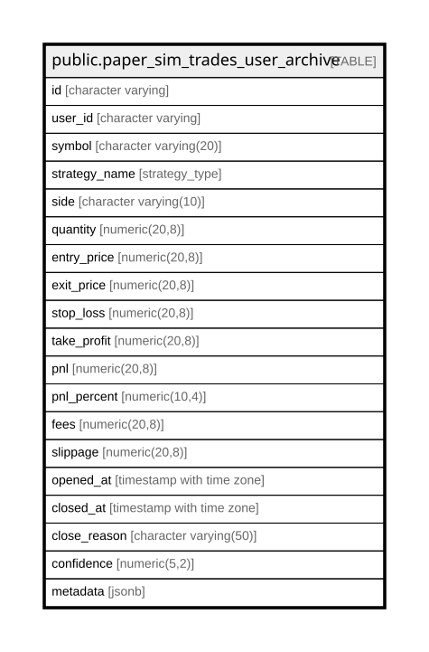

# public.paper_sim_trades_user_archive

## Columns

| Name | Type | Default | Nullable | Children | Parents | Comment |
| ---- | ---- | ------- | -------- | -------- | ------- | ------- |
| id | character varying |  | true |  |  |  |
| user_id | character varying |  | true |  |  |  |
| symbol | character varying(20) |  | true |  |  |  |
| strategy_name | strategy_type |  | true |  |  |  |
| side | character varying(10) |  | true |  |  |  |
| quantity | numeric(20,8) |  | true |  |  |  |
| entry_price | numeric(20,8) |  | true |  |  |  |
| exit_price | numeric(20,8) |  | true |  |  |  |
| stop_loss | numeric(20,8) |  | true |  |  |  |
| take_profit | numeric(20,8) |  | true |  |  |  |
| pnl | numeric(20,8) |  | true |  |  |  |
| pnl_percent | numeric(10,4) |  | true |  |  |  |
| fees | numeric(20,8) |  | true |  |  |  |
| slippage | numeric(20,8) |  | true |  |  |  |
| opened_at | timestamp with time zone |  | true |  |  |  |
| closed_at | timestamp with time zone |  | true |  |  |  |
| close_reason | character varying(50) |  | true |  |  |  |
| confidence | numeric(5,2) |  | true |  |  |  |
| metadata | jsonb |  | true |  |  |  |

## Viewpoints

| Name | Definition |
| ---- | ---------- |
| [public schema](viewpoint-schema-public.md) | All mapped relations in public. |

## Relations

---

> Generated by [tbls](https://github.com/k1LoW/tbls)
