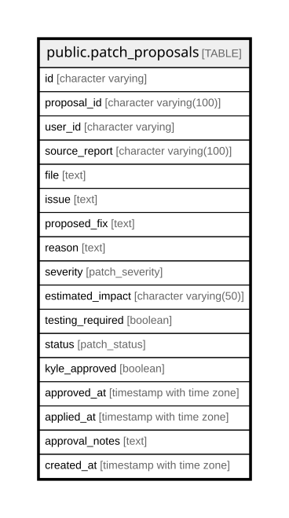

# public.patch_proposals

## Columns

| Name | Type | Default | Nullable | Children | Parents | Comment |
| ---- | ---- | ------- | -------- | -------- | ------- | ------- |
| id | character varying | gen_random_uuid() | false |  |  |  |
| proposal_id | character varying(100) |  | false |  |  |  |
| user_id | character varying |  | false |  |  |  |
| source_report | character varying(100) |  | false |  |  |  |
| file | text |  | false |  |  |  |
| issue | text |  | false |  |  |  |
| proposed_fix | text |  | false |  |  |  |
| reason | text |  | false |  |  |  |
| severity | patch_severity |  | false |  |  |  |
| estimated_impact | character varying(50) |  | false |  |  |  |
| testing_required | boolean | true | true |  |  |  |
| status | patch_status | 'pending'::patch_status | false |  |  |  |
| kyle_approved | boolean | false | false |  |  |  |
| approved_at | timestamp with time zone |  | true |  |  |  |
| applied_at | timestamp with time zone |  | true |  |  |  |
| approval_notes | text |  | true |  |  |  |
| created_at | timestamp with time zone | now() | true |  |  |  |

## Viewpoints

| Name | Definition |
| ---- | ---------- |
| [public schema](viewpoint-schema-public.md) | All mapped relations in public. |

## Constraints

| Name | Type | Definition |
| ---- | ---- | ---------- |
| patch_proposals_pkey | PRIMARY KEY | PRIMARY KEY (id) |
| patch_proposals_proposal_id_unique | UNIQUE | UNIQUE (proposal_id) |

## Indexes

| Name | Definition |
| ---- | ---------- |
| patch_proposals_pkey | CREATE UNIQUE INDEX patch_proposals_pkey ON public.patch_proposals USING btree (id) |
| patch_proposals_proposal_id_idx | CREATE UNIQUE INDEX patch_proposals_proposal_id_idx ON public.patch_proposals USING btree (proposal_id) |
| patch_proposals_proposal_id_unique | CREATE UNIQUE INDEX patch_proposals_proposal_id_unique ON public.patch_proposals USING btree (proposal_id) |
| patch_proposals_user_status_idx | CREATE INDEX patch_proposals_user_status_idx ON public.patch_proposals USING btree (user_id, status) |

## Relations

---

> Generated by [tbls](https://github.com/k1LoW/tbls)
