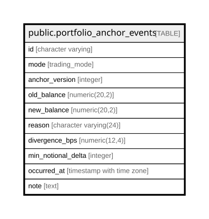

# public.portfolio_anchor_events

## Columns

| Name | Type | Default | Nullable | Children | Parents | Comment |
| ---- | ---- | ------- | -------- | -------- | ------- | ------- |
| id | character varying | gen_random_uuid() | false |  |  |  |
| mode | trading_mode |  | false |  |  |  |
| anchor_version | integer |  | false |  |  |  |
| old_balance | numeric(20,2) |  | true |  |  |  |
| new_balance | numeric(20,2) |  | false |  |  |  |
| reason | character varying(24) |  | false |  |  |  |
| divergence_bps | numeric(12,4) |  | true |  |  |  |
| min_notional_delta | integer |  | true |  |  |  |
| occurred_at | timestamp with time zone | now() | false |  |  |  |
| note | text |  | true |  |  |  |

## Viewpoints

| Name | Definition |
| ---- | ---------- |
| [public schema](viewpoint-schema-public.md) | All mapped relations in public. |

## Constraints

| Name | Type | Definition |
| ---- | ---- | ---------- |
| portfolio_anchor_events_pkey | PRIMARY KEY | PRIMARY KEY (id) |
| portfolio_anchor_events_reason_check | CHECK | CHECK (reason::text = ANY (ARRAY['start_new'::character varying, 'auto_divergence'::character varying, 'launch_snap'::character varying, 'measurement_override'::character varying]::text[])) |

## Indexes

| Name | Definition |
| ---- | ---------- |
| portfolio_anchor_events_mode_version_idx | CREATE UNIQUE INDEX portfolio_anchor_events_mode_version_idx ON public.portfolio_anchor_events USING btree (mode, anchor_version) |
| portfolio_anchor_events_occurred_at_idx | CREATE INDEX portfolio_anchor_events_occurred_at_idx ON public.portfolio_anchor_events USING btree (occurred_at) |
| portfolio_anchor_events_pkey | CREATE UNIQUE INDEX portfolio_anchor_events_pkey ON public.portfolio_anchor_events USING btree (id) |

## Relations

---

> Generated by [tbls](https://github.com/k1LoW/tbls)
