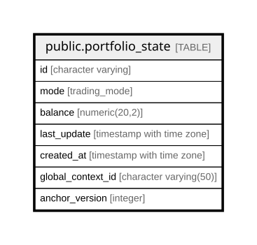

# public.portfolio_state

## Columns

| Name | Type | Default | Nullable | Children | Parents | Comment |
| ---- | ---- | ------- | -------- | -------- | ------- | ------- |
| id | character varying | gen_random_uuid() | false |  |  |  |
| mode | trading_mode |  | false |  |  |  |
| balance | numeric(20,2) |  | false |  |  |  |
| last_update | timestamp with time zone | now() | true |  |  |  |
| created_at | timestamp with time zone | now() | true |  |  |  |
| global_context_id | character varying(50) | 'default'::character varying | false |  |  |  |
| anchor_version | integer | 0 | false |  |  |  |

## Viewpoints

| Name | Definition |
| ---- | ---------- |
| [public schema](viewpoint-schema-public.md) | All mapped relations in public. |

## Constraints

| Name | Type | Definition |
| ---- | ---- | ---------- |
| portfolio_state_pkey | PRIMARY KEY | PRIMARY KEY (id) |

## Indexes

| Name | Definition |
| ---- | ---------- |
| idx_portfolio_state_mode | CREATE INDEX idx_portfolio_state_mode ON public.portfolio_state USING btree (mode) |
| portfolio_state_global_context_mode_idx | CREATE UNIQUE INDEX portfolio_state_global_context_mode_idx ON public.portfolio_state USING btree (global_context_id, mode) |
| portfolio_state_pkey | CREATE UNIQUE INDEX portfolio_state_pkey ON public.portfolio_state USING btree (id) |

## Relations

---

> Generated by [tbls](https://github.com/k1LoW/tbls)
