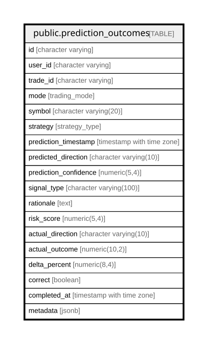

# public.prediction_outcomes

## Columns

| Name | Type | Default | Nullable | Children | Parents | Comment |
| ---- | ---- | ------- | -------- | -------- | ------- | ------- |
| id | character varying | gen_random_uuid() | false |  |  |  |
| user_id | character varying |  | false |  |  |  |
| trade_id | character varying |  | true |  |  |  |
| mode | trading_mode |  | false |  |  |  |
| symbol | character varying(20) |  | false |  |  |  |
| strategy | strategy_type |  | false |  |  |  |
| prediction_timestamp | timestamp with time zone | now() | true |  |  |  |
| predicted_direction | character varying(10) |  | false |  |  |  |
| prediction_confidence | numeric(5,4) |  | false |  |  |  |
| signal_type | character varying(100) |  | true |  |  |  |
| rationale | text |  | true |  |  |  |
| risk_score | numeric(5,4) |  | true |  |  |  |
| actual_direction | character varying(10) |  | true |  |  |  |
| actual_outcome | numeric(10,2) |  | true |  |  |  |
| delta_percent | numeric(8,4) |  | true |  |  |  |
| correct | boolean |  | true |  |  |  |
| completed_at | timestamp with time zone |  | true |  |  |  |
| metadata | jsonb |  | true |  |  |  |

## Viewpoints

| Name | Definition |
| ---- | ---------- |
| [public schema](viewpoint-schema-public.md) | All mapped relations in public. |

## Constraints

| Name | Type | Definition |
| ---- | ---- | ---------- |
| prediction_outcomes_pkey | PRIMARY KEY | PRIMARY KEY (id) |

## Indexes

| Name | Definition |
| ---- | ---------- |
| prediction_outcomes_pkey | CREATE UNIQUE INDEX prediction_outcomes_pkey ON public.prediction_outcomes USING btree (id) |

## Relations

---

> Generated by [tbls](https://github.com/k1LoW/tbls)
