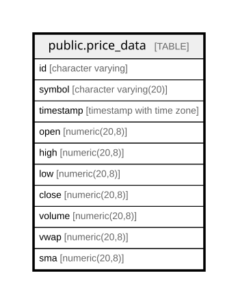

# public.price_data

## Columns

| Name | Type | Default | Nullable | Children | Parents | Comment |
| ---- | ---- | ------- | -------- | -------- | ------- | ------- |
| id | character varying | gen_random_uuid() | false |  |  |  |
| symbol | character varying(20) |  | false |  |  |  |
| timestamp | timestamp with time zone |  | false |  |  |  |
| open | numeric(20,8) |  | false |  |  |  |
| high | numeric(20,8) |  | false |  |  |  |
| low | numeric(20,8) |  | false |  |  |  |
| close | numeric(20,8) |  | false |  |  |  |
| volume | numeric(20,8) |  | false |  |  |  |
| vwap | numeric(20,8) |  | true |  |  |  |
| sma | numeric(20,8) |  | true |  |  |  |

## Viewpoints

| Name | Definition |
| ---- | ---------- |
| [public schema](viewpoint-schema-public.md) | All mapped relations in public. |

## Constraints

| Name | Type | Definition |
| ---- | ---- | ---------- |
| price_data_pkey | PRIMARY KEY | PRIMARY KEY (id) |

## Indexes

| Name | Definition |
| ---- | ---------- |
| price_data_pkey | CREATE UNIQUE INDEX price_data_pkey ON public.price_data USING btree (id) |

## Relations

---

> Generated by [tbls](https://github.com/k1LoW/tbls)
