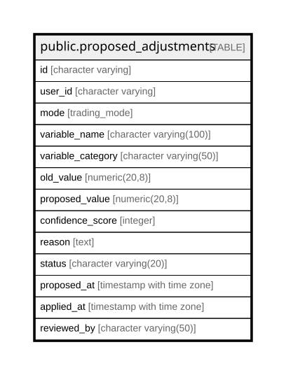

# public.proposed_adjustments

## Columns

| Name | Type | Default | Nullable | Children | Parents | Comment |
| ---- | ---- | ------- | -------- | -------- | ------- | ------- |
| id | character varying | gen_random_uuid() | false |  |  |  |
| user_id | character varying |  | false |  |  |  |
| mode | trading_mode |  | false |  |  |  |
| variable_name | character varying(100) |  | false |  |  |  |
| variable_category | character varying(50) |  | false |  |  |  |
| old_value | numeric(20,8) |  | false |  |  |  |
| proposed_value | numeric(20,8) |  | false |  |  |  |
| confidence_score | integer |  | false |  |  |  |
| reason | text |  | true |  |  |  |
| status | character varying(20) | 'pending'::character varying | true |  |  |  |
| proposed_at | timestamp with time zone | now() | true |  |  |  |
| applied_at | timestamp with time zone |  | true |  |  |  |
| reviewed_by | character varying(50) |  | true |  |  |  |

## Viewpoints

| Name | Definition |
| ---- | ---------- |
| [public schema](viewpoint-schema-public.md) | All mapped relations in public. |

## Constraints

| Name | Type | Definition |
| ---- | ---- | ---------- |
| proposed_adjustments_pkey | PRIMARY KEY | PRIMARY KEY (id) |

## Indexes

| Name | Definition |
| ---- | ---------- |
| proposed_adjustments_pkey | CREATE UNIQUE INDEX proposed_adjustments_pkey ON public.proposed_adjustments USING btree (id) |
| proposed_adjustments_user_mode_proposed_idx | CREATE INDEX proposed_adjustments_user_mode_proposed_idx ON public.proposed_adjustments USING btree (user_id, mode, proposed_at) |

## Relations

---

> Generated by [tbls](https://github.com/k1LoW/tbls)
