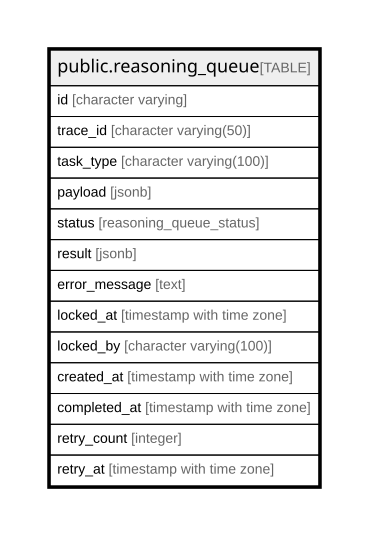

# public.reasoning_queue

## Columns

| Name | Type | Default | Nullable | Children | Parents | Comment |
| ---- | ---- | ------- | -------- | -------- | ------- | ------- |
| id | character varying | gen_random_uuid() | false |  |  |  |
| trace_id | character varying(50) |  | false |  |  |  |
| task_type | character varying(100) |  | false |  |  |  |
| payload | jsonb |  | false |  |  |  |
| status | reasoning_queue_status | 'pending'::reasoning_queue_status | false |  |  |  |
| result | jsonb |  | true |  |  |  |
| error_message | text |  | true |  |  |  |
| locked_at | timestamp with time zone |  | true |  |  |  |
| locked_by | character varying(100) |  | true |  |  |  |
| created_at | timestamp with time zone | now() | false |  |  |  |
| completed_at | timestamp with time zone |  | true |  |  |  |
| retry_count | integer | 0 | false |  |  |  |
| retry_at | timestamp with time zone |  | true |  |  |  |

## Viewpoints

| Name | Definition |
| ---- | ---------- |
| [public schema](viewpoint-schema-public.md) | All mapped relations in public. |

## Constraints

| Name | Type | Definition |
| ---- | ---- | ---------- |
| reasoning_queue_pkey | PRIMARY KEY | PRIMARY KEY (id) |

## Indexes

| Name | Definition |
| ---- | ---------- |
| reasoning_queue_created_at_idx | CREATE INDEX reasoning_queue_created_at_idx ON public.reasoning_queue USING btree (created_at) |
| reasoning_queue_pkey | CREATE UNIQUE INDEX reasoning_queue_pkey ON public.reasoning_queue USING btree (id) |
| reasoning_queue_status_idx | CREATE INDEX reasoning_queue_status_idx ON public.reasoning_queue USING btree (status) |
| reasoning_queue_task_type_idx | CREATE INDEX reasoning_queue_task_type_idx ON public.reasoning_queue USING btree (task_type) |
| reasoning_queue_trace_id_idx | CREATE INDEX reasoning_queue_trace_id_idx ON public.reasoning_queue USING btree (trace_id) |

## Relations

---

> Generated by [tbls](https://github.com/k1LoW/tbls)
