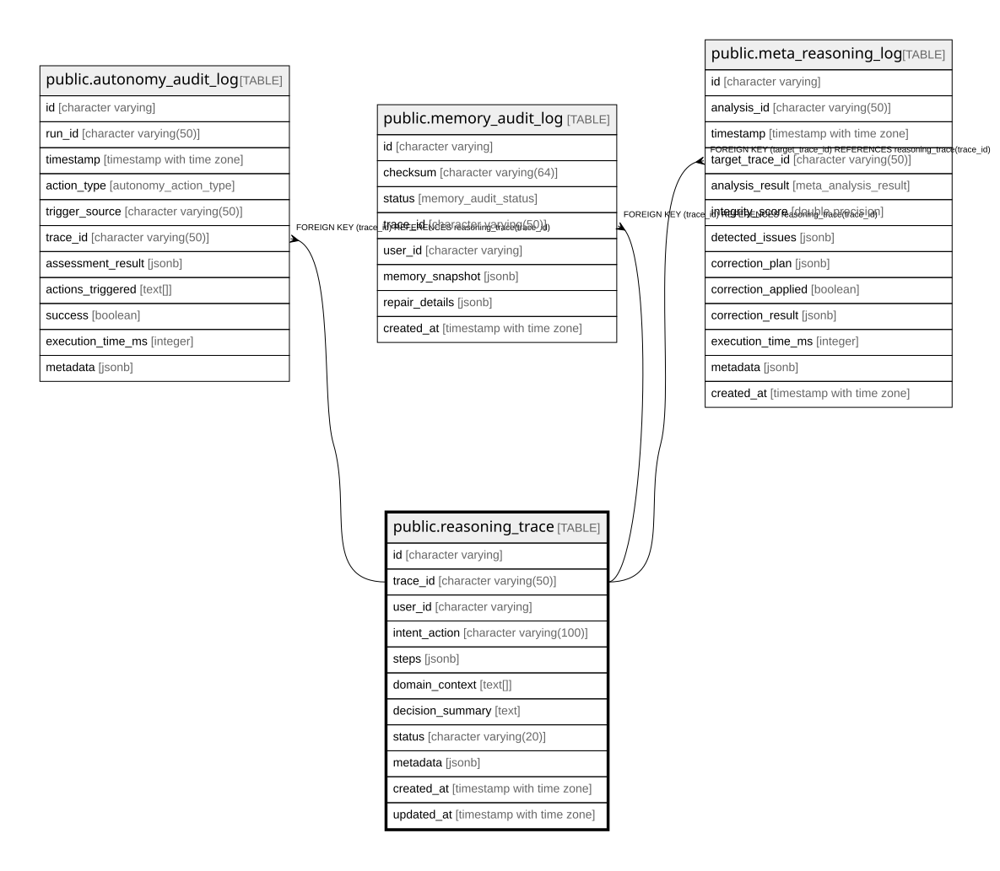

# public.reasoning_trace

## Columns

| Name | Type | Default | Nullable | Children | Parents | Comment |
| ---- | ---- | ------- | -------- | -------- | ------- | ------- |
| id | character varying | gen_random_uuid() | false |  |  |  |
| trace_id | character varying(50) |  | false | [public.autonomy_audit_log](public.autonomy_audit_log.md) [public.memory_audit_log](public.memory_audit_log.md) [public.meta_reasoning_log](public.meta_reasoning_log.md) |  |  |
| user_id | character varying |  | false |  |  |  |
| intent_action | character varying(100) |  | true |  |  |  |
| steps | jsonb |  | false |  |  |  |
| domain_context | text[] | ARRAY[]::text[] | true |  |  |  |
| decision_summary | text |  | true |  |  |  |
| status | character varying(20) | 'in_progress'::character varying | false |  |  |  |
| metadata | jsonb |  | true |  |  |  |
| created_at | timestamp with time zone | now() | false |  |  |  |
| updated_at | timestamp with time zone | now() | false |  |  |  |

## Viewpoints

| Name | Definition |
| ---- | ---------- |
| [public schema](viewpoint-schema-public.md) | All mapped relations in public. |

## Constraints

| Name | Type | Definition |
| ---- | ---- | ---------- |
| reasoning_trace_pkey | PRIMARY KEY | PRIMARY KEY (id) |
| reasoning_trace_trace_id_unique | UNIQUE | UNIQUE (trace_id) |

## Indexes

| Name | Definition |
| ---- | ---------- |
| reasoning_trace_created_at_idx | CREATE INDEX reasoning_trace_created_at_idx ON public.reasoning_trace USING btree (created_at) |
| reasoning_trace_pkey | CREATE UNIQUE INDEX reasoning_trace_pkey ON public.reasoning_trace USING btree (id) |
| reasoning_trace_status_idx | CREATE INDEX reasoning_trace_status_idx ON public.reasoning_trace USING btree (status) |
| reasoning_trace_trace_id_idx | CREATE INDEX reasoning_trace_trace_id_idx ON public.reasoning_trace USING btree (trace_id) |
| reasoning_trace_trace_id_unique | CREATE UNIQUE INDEX reasoning_trace_trace_id_unique ON public.reasoning_trace USING btree (trace_id) |
| reasoning_trace_user_id_idx | CREATE INDEX reasoning_trace_user_id_idx ON public.reasoning_trace USING btree (user_id) |

## Relations

---

> Generated by [tbls](https://github.com/k1LoW/tbls)
