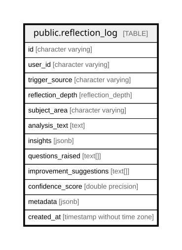

# public.reflection_log

## Columns

| Name | Type | Default | Nullable | Children | Parents | Comment |
| ---- | ---- | ------- | -------- | -------- | ------- | ------- |
| id | character varying | (gen_random_uuid())::text | false |  |  |  |
| user_id | character varying |  | true |  |  |  |
| trigger_source | character varying |  | false |  |  |  |
| reflection_depth | reflection_depth | 'analytical'::reflection_depth | false |  |  |  |
| subject_area | character varying |  | false |  |  |  |
| analysis_text | text |  | false |  |  |  |
| insights | jsonb |  | true |  |  |  |
| questions_raised | text[] |  | true |  |  |  |
| improvement_suggestions | text[] |  | true |  |  |  |
| confidence_score | double precision |  | true |  |  |  |
| metadata | jsonb |  | true |  |  |  |
| created_at | timestamp without time zone | now() | true |  |  |  |

## Viewpoints

| Name | Definition |
| ---- | ---------- |
| [public schema](viewpoint-schema-public.md) | All mapped relations in public. |

## Constraints

| Name | Type | Definition |
| ---- | ---- | ---------- |
| reflection_log_pkey | PRIMARY KEY | PRIMARY KEY (id) |

## Indexes

| Name | Definition |
| ---- | ---------- |
| idx_reflection_log_created_at | CREATE INDEX idx_reflection_log_created_at ON public.reflection_log USING btree (created_at) |
| idx_reflection_log_depth | CREATE INDEX idx_reflection_log_depth ON public.reflection_log USING btree (reflection_depth) |
| idx_reflection_log_user_id | CREATE INDEX idx_reflection_log_user_id ON public.reflection_log USING btree (user_id) |
| reflection_log_pkey | CREATE UNIQUE INDEX reflection_log_pkey ON public.reflection_log USING btree (id) |

## Relations

---

> Generated by [tbls](https://github.com/k1LoW/tbls)
