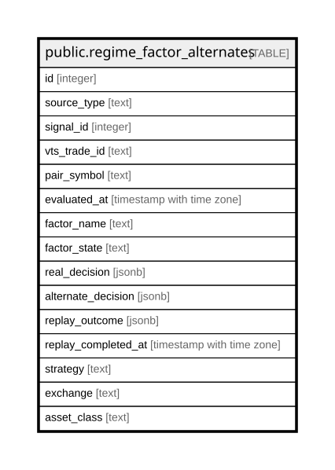

# public.regime_factor_alternates

## Columns

| Name | Type | Default | Nullable | Children | Parents | Comment |
| ---- | ---- | ------- | -------- | -------- | ------- | ------- |
| id | integer | nextval('regime_factor_alternates_id_seq'::regclass) | false |  |  |  |
| source_type | text |  | false |  |  |  |
| signal_id | integer |  | true |  |  |  |
| vts_trade_id | text |  | true |  |  |  |
| pair_symbol | text |  | false |  |  |  |
| evaluated_at | timestamp with time zone | now() | false |  |  |  |
| factor_name | text |  | false |  |  |  |
| factor_state | text |  | false |  |  |  |
| real_decision | jsonb |  | false |  |  |  |
| alternate_decision | jsonb |  | false |  |  |  |
| replay_outcome | jsonb |  | true |  |  |  |
| replay_completed_at | timestamp with time zone |  | true |  |  |  |
| strategy | text |  | true |  |  |  |
| exchange | text | 'kraken'::text | false |  |  |  |
| asset_class | text | 'crypto_spot'::text | false |  |  |  |

## Viewpoints

| Name | Definition |
| ---- | ---------- |
| [public schema](viewpoint-schema-public.md) | All mapped relations in public. |

## Constraints

| Name | Type | Definition |
| ---- | ---- | ---------- |
| regime_factor_alternates_factor_state_check | CHECK | CHECK (factor_state = ANY (ARRAY['alternate_disabled'::text, 'alternate_enabled'::text])) |
| regime_factor_alternates_pkey | PRIMARY KEY | PRIMARY KEY (id) |
| regime_factor_alternates_source_type_check | CHECK | CHECK (source_type = ANY (ARRAY['active_signal'::text, 'vts_trade'::text])) |
| regime_factor_alternates_source_xor | CHECK | CHECK (source_type = 'active_signal'::text AND signal_id IS NOT NULL AND vts_trade_id IS NULL OR source_type = 'vts_trade'::text AND signal_id IS NULL AND vts_trade_id IS NOT NULL) |

## Indexes

| Name | Definition |
| ---- | ---------- |
| idx_regime_factor_alternates_asset_evaluated | CREATE INDEX idx_regime_factor_alternates_asset_evaluated ON public.regime_factor_alternates USING btree (asset_class, evaluated_at DESC) WHERE (replay_completed_at IS NOT NULL) |
| regime_factor_alternates_factor_time_idx | CREATE INDEX regime_factor_alternates_factor_time_idx ON public.regime_factor_alternates USING btree (factor_name, evaluated_at DESC) |
| regime_factor_alternates_natural_key_idx | CREATE INDEX regime_factor_alternates_natural_key_idx ON public.regime_factor_alternates USING btree (pair_symbol, evaluated_at, strategy) |
| regime_factor_alternates_pair_time_idx | CREATE INDEX regime_factor_alternates_pair_time_idx ON public.regime_factor_alternates USING btree (pair_symbol, evaluated_at DESC) |
| regime_factor_alternates_pending_replay_idx | CREATE INDEX regime_factor_alternates_pending_replay_idx ON public.regime_factor_alternates USING btree (replay_completed_at) WHERE (replay_completed_at IS NULL) |
| regime_factor_alternates_pkey | CREATE UNIQUE INDEX regime_factor_alternates_pkey ON public.regime_factor_alternates USING btree (id) |
| regime_factor_alternates_signal_idx | CREATE INDEX regime_factor_alternates_signal_idx ON public.regime_factor_alternates USING btree (signal_id) WHERE (signal_id IS NOT NULL) |
| regime_factor_alternates_vts_trade_idx | CREATE INDEX regime_factor_alternates_vts_trade_idx ON public.regime_factor_alternates USING btree (vts_trade_id) WHERE (vts_trade_id IS NOT NULL) |

## Relations

---

> Generated by [tbls](https://github.com/k1LoW/tbls)
