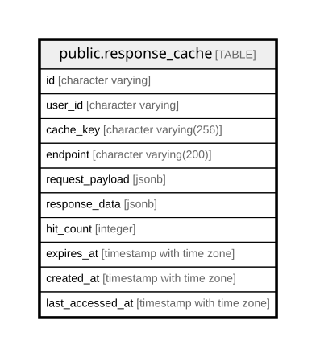

# public.response_cache

## Columns

| Name | Type | Default | Nullable | Children | Parents | Comment |
| ---- | ---- | ------- | -------- | -------- | ------- | ------- |
| id | character varying | gen_random_uuid() | false |  |  |  |
| user_id | character varying |  | false |  |  |  |
| cache_key | character varying(256) |  | false |  |  |  |
| endpoint | character varying(200) |  | false |  |  |  |
| request_payload | jsonb |  | true |  |  |  |
| response_data | jsonb |  | false |  |  |  |
| hit_count | integer | 1 | true |  |  |  |
| expires_at | timestamp with time zone |  | false |  |  |  |
| created_at | timestamp with time zone | now() | true |  |  |  |
| last_accessed_at | timestamp with time zone | now() | true |  |  |  |

## Viewpoints

| Name | Definition |
| ---- | ---------- |
| [public schema](viewpoint-schema-public.md) | All mapped relations in public. |

## Constraints

| Name | Type | Definition |
| ---- | ---- | ---------- |
| response_cache_pkey | PRIMARY KEY | PRIMARY KEY (id) |

## Indexes

| Name | Definition |
| ---- | ---------- |
| response_cache_expires_at_idx | CREATE INDEX response_cache_expires_at_idx ON public.response_cache USING btree (expires_at) |
| response_cache_pkey | CREATE UNIQUE INDEX response_cache_pkey ON public.response_cache USING btree (id) |
| response_cache_user_cache_key_idx | CREATE UNIQUE INDEX response_cache_user_cache_key_idx ON public.response_cache USING btree (user_id, cache_key) |

## Relations

---

> Generated by [tbls](https://github.com/k1LoW/tbls)
