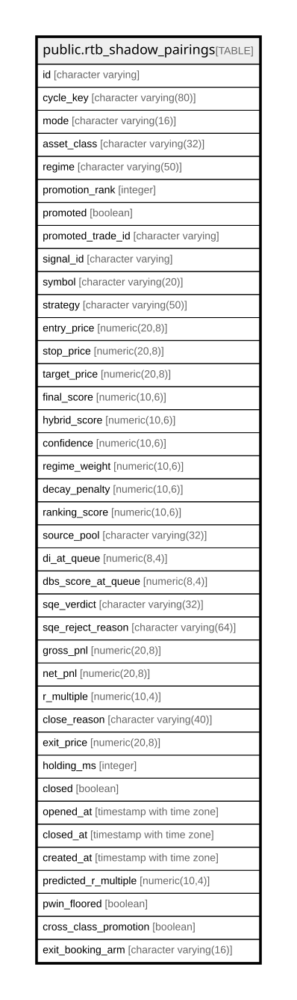

# public.rtb_shadow_pairings

## Columns

| Name | Type | Default | Nullable | Children | Parents | Comment |
| ---- | ---- | ------- | -------- | -------- | ------- | ------- |
| id | character varying |  | false |  |  |  |
| cycle_key | character varying(80) |  | false |  |  |  |
| mode | character varying(16) |  | false |  |  |  |
| asset_class | character varying(32) |  | false |  |  |  |
| regime | character varying(50) |  | true |  |  |  |
| promotion_rank | integer |  | true |  |  |  |
| promoted | boolean | false | false |  |  |  |
| promoted_trade_id | character varying |  | true |  |  |  |
| signal_id | character varying |  | true |  |  |  |
| symbol | character varying(20) |  | false |  |  |  |
| strategy | character varying(50) |  | false |  |  |  |
| entry_price | numeric(20,8) |  | true |  |  |  |
| stop_price | numeric(20,8) |  | true |  |  |  |
| target_price | numeric(20,8) |  | true |  |  |  |
| final_score | numeric(10,6) |  | true |  |  |  |
| hybrid_score | numeric(10,6) |  | true |  |  |  |
| confidence | numeric(10,6) |  | true |  |  |  |
| regime_weight | numeric(10,6) |  | true |  |  |  |
| decay_penalty | numeric(10,6) |  | true |  |  |  |
| ranking_score | numeric(10,6) |  | true |  |  |  |
| source_pool | character varying(32) |  | true |  |  |  |
| di_at_queue | numeric(8,4) |  | true |  |  |  |
| dbs_score_at_queue | numeric(8,4) |  | true |  |  |  |
| sqe_verdict | character varying(32) |  | true |  |  |  |
| sqe_reject_reason | character varying(64) |  | true |  |  |  |
| gross_pnl | numeric(20,8) |  | true |  |  |  |
| net_pnl | numeric(20,8) |  | true |  |  |  |
| r_multiple | numeric(10,4) |  | true |  |  |  |
| close_reason | character varying(40) |  | true |  |  |  |
| exit_price | numeric(20,8) |  | true |  |  |  |
| holding_ms | integer |  | true |  |  |  |
| closed | boolean | false | false |  |  |  |
| opened_at | timestamp with time zone | now() | true |  |  |  |
| closed_at | timestamp with time zone |  | true |  |  |  |
| created_at | timestamp with time zone | now() | true |  |  |  |
| predicted_r_multiple | numeric(10,4) |  | true |  |  |  |
| pwin_floored | boolean | false | false |  |  |  |
| cross_class_promotion | boolean | false | false |  |  |  |
| exit_booking_arm | character varying(16) |  | true |  |  | B-VTS-NO-DECISION-VALVE (3n.q3): how the shadow close was booked - bid \| clamp_no_bid \| clamp_no_mark; the clamp arms are unpriced closes (timeout_unpriced). NULL = written before this column existed (this batch deploy), never an arm. |

## Viewpoints

| Name | Definition |
| ---- | ---------- |
| [public schema](viewpoint-schema-public.md) | All mapped relations in public. |

## Constraints

| Name | Type | Definition |
| ---- | ---- | ---------- |
| rtb_shadow_pairings_pkey | PRIMARY KEY | PRIMARY KEY (id) |

## Indexes

| Name | Definition |
| ---- | ---------- |
| rtb_shadow_pairings_closed_idx | CREATE INDEX rtb_shadow_pairings_closed_idx ON public.rtb_shadow_pairings USING btree (closed) |
| rtb_shadow_pairings_cycle_key_idx | CREATE INDEX rtb_shadow_pairings_cycle_key_idx ON public.rtb_shadow_pairings USING btree (cycle_key) |
| rtb_shadow_pairings_mode_asset_class_idx | CREATE INDEX rtb_shadow_pairings_mode_asset_class_idx ON public.rtb_shadow_pairings USING btree (mode, asset_class) |
| rtb_shadow_pairings_pkey | CREATE UNIQUE INDEX rtb_shadow_pairings_pkey ON public.rtb_shadow_pairings USING btree (id) |

## Relations

---

> Generated by [tbls](https://github.com/k1LoW/tbls)
