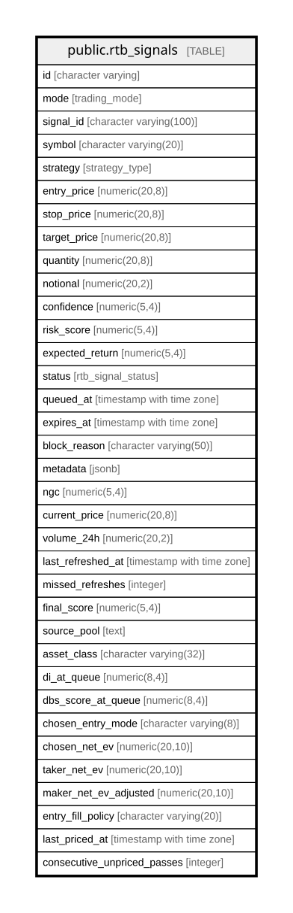

# public.rtb_signals

## Columns

| Name | Type | Default | Nullable | Children | Parents | Comment |
| ---- | ---- | ------- | -------- | -------- | ------- | ------- |
| id | character varying | gen_random_uuid() | false |  |  |  |
| mode | trading_mode |  | false |  |  |  |
| signal_id | character varying(100) |  | false |  |  |  |
| symbol | character varying(20) |  | false |  |  |  |
| strategy | strategy_type |  | false |  |  |  |
| entry_price | numeric(20,8) |  | false |  |  |  |
| stop_price | numeric(20,8) |  | false |  |  |  |
| target_price | numeric(20,8) |  | true |  |  |  |
| quantity | numeric(20,8) |  | true |  |  |  |
| notional | numeric(20,2) |  | true |  |  |  |
| confidence | numeric(5,4) |  | false |  |  |  |
| risk_score | numeric(5,4) |  | false |  |  |  |
| expected_return | numeric(5,4) |  | false |  |  |  |
| status | rtb_signal_status |  | false |  |  |  |
| queued_at | timestamp with time zone | now() | false |  |  |  |
| expires_at | timestamp with time zone |  | true |  |  |  |
| block_reason | character varying(50) |  | true |  |  |  |
| metadata | jsonb |  | true |  |  |  |
| ngc | numeric(5,4) |  | true |  |  |  |
| current_price | numeric(20,8) |  | true |  |  |  |
| volume_24h | numeric(20,2) |  | true |  |  |  |
| last_refreshed_at | timestamp with time zone |  | true |  |  |  |
| missed_refreshes | integer | 0 | true |  |  |  |
| final_score | numeric(5,4) |  | true |  |  |  |
| source_pool | text |  | true |  |  |  |
| asset_class | character varying(32) |  | true |  |  | B79.0n.RTB Phase 1 2026-05-27: per-class queue partitioning key. NULL allowed only during Phase 1+2 backfill window. Post-Phase-3 CHECK constraint + Phase 4 (contingent) SET NOT NULL. |
| di_at_queue | numeric(8,4) |  | true |  |  | reorg-B3 #233 2026-06-24: Directional Integrity [0-100] captured AT QUEUE from the routing-time FX5 survivor snapshot (active-filter-pool entry). NOT freshest-at-instant. NULL ⇒ kernel default DI=50. Do NOT refix to a live MCE re-read. |
| dbs_score_at_queue | numeric(8,4) |  | true |  |  | reorg-B3 #233 2026-06-24: Directional Bias Score [-1,1] captured AT QUEUE from the routing-time FX5 survivor snapshot — the SAME dbsScore that drove strong-trend routing (coherence with the open-gate strong-trend pWin branch). NULL ⇒ kernel strong-trend 0.40 floor. Do NOT refix to a live MCE re-read. |
| chosen_entry_mode | character varying(8) |  | true |  |  |  |
| chosen_net_ev | numeric(20,10) |  | true |  |  |  |
| taker_net_ev | numeric(20,10) |  | true |  |  |  |
| maker_net_ev_adjusted | numeric(20,10) |  | true |  |  |  |
| entry_fill_policy | character varying(20) |  | true |  |  |  |
| last_priced_at | timestamp with time zone |  | true |  |  |  |
| consecutive_unpriced_passes | integer | 0 | false |  |  |  |

## Viewpoints

| Name | Definition |
| ---- | ---------- |
| [public schema](viewpoint-schema-public.md) | All mapped relations in public. |

## Constraints

| Name | Type | Definition |
| ---- | ---- | ---------- |
| rtb_signals_asset_class_not_null_chk | CHECK | CHECK (asset_class IS NOT NULL) |
| rtb_signals_pkey | PRIMARY KEY | PRIMARY KEY (id) |

## Indexes

| Name | Definition |
| ---- | ---------- |
| rtb_signals_expires_at_idx | CREATE INDEX rtb_signals_expires_at_idx ON public.rtb_signals USING btree (expires_at) |
| rtb_signals_final_score_idx | CREATE INDEX rtb_signals_final_score_idx ON public.rtb_signals USING btree (final_score) |
| rtb_signals_mode_asset_class_status_idx | CREATE INDEX rtb_signals_mode_asset_class_status_idx ON public.rtb_signals USING btree (mode, asset_class, status) |
| rtb_signals_mode_status_idx | CREATE INDEX rtb_signals_mode_status_idx ON public.rtb_signals USING btree (mode, status) |
| rtb_signals_pkey | CREATE UNIQUE INDEX rtb_signals_pkey ON public.rtb_signals USING btree (id) |
| rtb_signals_queued_at_idx | CREATE INDEX rtb_signals_queued_at_idx ON public.rtb_signals USING btree (queued_at) |
| rtb_signals_symbol_strategy_idx | CREATE UNIQUE INDEX rtb_signals_symbol_strategy_idx ON public.rtb_signals USING btree (mode, symbol, strategy) |

## Relations

---

> Generated by [tbls](https://github.com/k1LoW/tbls)
