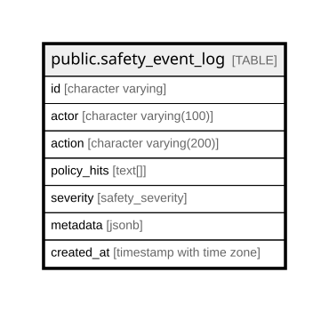

# public.safety_event_log

## Columns

| Name | Type | Default | Nullable | Children | Parents | Comment |
| ---- | ---- | ------- | -------- | -------- | ------- | ------- |
| id | character varying | gen_random_uuid() | false |  |  |  |
| actor | character varying(100) |  | false |  |  |  |
| action | character varying(200) |  | false |  |  |  |
| policy_hits | text[] | ARRAY[]::text[] | false |  |  |  |
| severity | safety_severity |  | false |  |  |  |
| metadata | jsonb |  | true |  |  |  |
| created_at | timestamp with time zone | now() | false |  |  |  |

## Viewpoints

| Name | Definition |
| ---- | ---------- |
| [public schema](viewpoint-schema-public.md) | All mapped relations in public. |

## Constraints

| Name | Type | Definition |
| ---- | ---- | ---------- |
| safety_event_log_pkey | PRIMARY KEY | PRIMARY KEY (id) |

## Indexes

| Name | Definition |
| ---- | ---------- |
| safety_event_log_actor_idx | CREATE INDEX safety_event_log_actor_idx ON public.safety_event_log USING btree (actor) |
| safety_event_log_created_at_idx | CREATE INDEX safety_event_log_created_at_idx ON public.safety_event_log USING btree (created_at) |
| safety_event_log_pkey | CREATE UNIQUE INDEX safety_event_log_pkey ON public.safety_event_log USING btree (id) |
| safety_event_log_severity_idx | CREATE INDEX safety_event_log_severity_idx ON public.safety_event_log USING btree (severity) |

## Relations

---

> Generated by [tbls](https://github.com/k1LoW/tbls)
