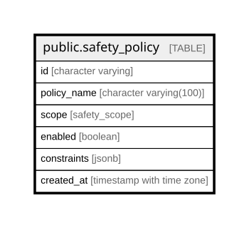

# public.safety_policy

## Columns

| Name | Type | Default | Nullable | Children | Parents | Comment |
| ---- | ---- | ------- | -------- | -------- | ------- | ------- |
| id | character varying | gen_random_uuid() | false |  |  |  |
| policy_name | character varying(100) |  | false |  |  |  |
| scope | safety_scope |  | false |  |  |  |
| enabled | boolean | true | false |  |  |  |
| constraints | jsonb |  | false |  |  |  |
| created_at | timestamp with time zone | now() | false |  |  |  |

## Viewpoints

| Name | Definition |
| ---- | ---------- |
| [public schema](viewpoint-schema-public.md) | All mapped relations in public. |

## Constraints

| Name | Type | Definition |
| ---- | ---- | ---------- |
| safety_policy_pkey | PRIMARY KEY | PRIMARY KEY (id) |
| safety_policy_policy_name_key | UNIQUE | UNIQUE (policy_name) |

## Indexes

| Name | Definition |
| ---- | ---------- |
| safety_policy_enabled_idx | CREATE INDEX safety_policy_enabled_idx ON public.safety_policy USING btree (enabled) |
| safety_policy_pkey | CREATE UNIQUE INDEX safety_policy_pkey ON public.safety_policy USING btree (id) |
| safety_policy_policy_name_idx | CREATE INDEX safety_policy_policy_name_idx ON public.safety_policy USING btree (policy_name) |
| safety_policy_policy_name_key | CREATE UNIQUE INDEX safety_policy_policy_name_key ON public.safety_policy USING btree (policy_name) |
| safety_policy_scope_idx | CREATE INDEX safety_policy_scope_idx ON public.safety_policy USING btree (scope) |

## Relations

---

> Generated by [tbls](https://github.com/k1LoW/tbls)
