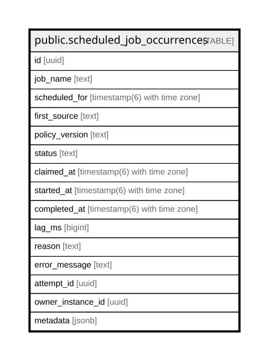

# public.scheduled_job_occurrences

## Description

B-CRON-MISSED-CATCHUP: durable admission and decision ledger; scheduled_tasks_audit remains terminal fire evidence.

## Columns

| Name | Type | Default | Nullable | Children | Parents | Comment |
| ---- | ---- | ------- | -------- | -------- | ------- | ------- |
| id | uuid | gen_random_uuid() | false |  |  |  |
| job_name | text |  | false |  |  |  |
| scheduled_for | timestamp(6) with time zone |  | false |  |  | The true cron calendar boundary, never callback arrival time. |
| first_source | text |  | false |  |  | The source that first won durable admission: natural or missed_catchup. |
| policy_version | text |  | false |  |  |  |
| status | text |  | false |  |  |  |
| claimed_at | timestamp(6) with time zone | clock_timestamp() | false |  |  |  |
| started_at | timestamp(6) with time zone |  | true |  |  |  |
| completed_at | timestamp(6) with time zone |  | true |  |  |  |
| lag_ms | bigint |  | false |  |  |  |
| reason | text |  | true |  |  |  |
| error_message | text |  | true |  |  |  |
| attempt_id | uuid |  | true |  |  |  |
| owner_instance_id | uuid |  | true |  |  |  |
| metadata | jsonb | '{}'::jsonb | false |  |  |  |

## Viewpoints

| Name | Definition |
| ---- | ---------- |
| [public schema](viewpoint-schema-public.md) | All mapped relations in public. |

## Constraints

| Name | Type | Definition |
| ---- | ---- | ---------- |
| scheduled_job_occurrences_identity_unique | UNIQUE | UNIQUE (job_name, scheduled_for) |
| scheduled_job_occurrences_lag_check | CHECK | CHECK (lag_ms >= 0) |
| scheduled_job_occurrences_pkey | PRIMARY KEY | PRIMARY KEY (id) |
| scheduled_job_occurrences_source_check | CHECK | CHECK (first_source = ANY (ARRAY['natural'::text, 'missed_catchup'::text])) |
| scheduled_job_occurrences_state_shape_check | CHECK | CHECK (status = 'claimed'::text AND started_at IS NULL AND completed_at IS NULL OR status = 'running'::text AND started_at IS NOT NULL AND completed_at IS NULL OR status = 'succeeded'::text AND started_at IS NOT NULL AND completed_at IS NOT NULL OR status = 'failed'::text AND started_at IS NOT NULL AND completed_at IS NOT NULL AND error_message IS NOT NULL OR status = 'skipped'::text AND started_at IS NULL AND completed_at IS NOT NULL AND reason IS NOT NULL OR status = 'indeterminate'::text AND completed_at IS NOT NULL AND reason IS NOT NULL) |
| scheduled_job_occurrences_status_check | CHECK | CHECK (status = ANY (ARRAY['claimed'::text, 'running'::text, 'succeeded'::text, 'failed'::text, 'skipped'::text, 'indeterminate'::text])) |

## Indexes

| Name | Definition |
| ---- | ---------- |
| scheduled_job_occurrences_identity_unique | CREATE UNIQUE INDEX scheduled_job_occurrences_identity_unique ON public.scheduled_job_occurrences USING btree (job_name, scheduled_for) |
| scheduled_job_occurrences_job_boundary_idx | CREATE INDEX scheduled_job_occurrences_job_boundary_idx ON public.scheduled_job_occurrences USING btree (job_name, scheduled_for DESC) |
| scheduled_job_occurrences_pkey | CREATE UNIQUE INDEX scheduled_job_occurrences_pkey ON public.scheduled_job_occurrences USING btree (id) |
| scheduled_job_occurrences_unfinished_idx | CREATE INDEX scheduled_job_occurrences_unfinished_idx ON public.scheduled_job_occurrences USING btree (status, claimed_at) WHERE (status = ANY (ARRAY['claimed'::text, 'running'::text])) |

## Relations

---

> Generated by [tbls](https://github.com/k1LoW/tbls)
