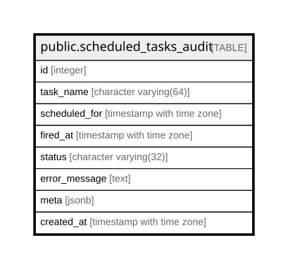

# public.scheduled_tasks_audit

## Description

B-NEW-36 (2026-05-20): forensic record of scheduled-task fires from the off-hours session-lifecycle controller. task_name values: weekend_shutdown | weekend_restart | boot_state_reconciliation. status values: pending | success | error.

## Columns

| Name | Type | Default | Nullable | Children | Parents | Comment |
| ---- | ---- | ------- | -------- | -------- | ------- | ------- |
| id | integer | nextval('scheduled_tasks_audit_id_seq'::regclass) | false |  |  |  |
| task_name | character varying(64) |  | false |  |  |  |
| scheduled_for | timestamp with time zone |  | false |  |  | When this task was supposed to fire. For boot_state_reconciliation rows this is server boot time (= fired_at = created_at). |
| fired_at | timestamp with time zone |  | true |  |  |  |
| status | character varying(32) |  | false |  |  |  |
| error_message | text |  | true |  |  |  |
| meta | jsonb |  | true |  |  | JSONB with task-specific context (snapshot row counts, suspended trade counts, computed inside-weekend-window state, etc.). |
| created_at | timestamp with time zone | now() | false |  |  |  |

## Viewpoints

| Name | Definition |
| ---- | ---------- |
| [public schema](viewpoint-schema-public.md) | All mapped relations in public. |

## Constraints

| Name | Type | Definition |
| ---- | ---- | ---------- |
| scheduled_tasks_audit_pkey | PRIMARY KEY | PRIMARY KEY (id) |

## Indexes

| Name | Definition |
| ---- | ---------- |
| idx_scheduled_tasks_audit_name_status_fired | CREATE INDEX idx_scheduled_tasks_audit_name_status_fired ON public.scheduled_tasks_audit USING btree (task_name, status, fired_at DESC) |
| scheduled_tasks_audit_pkey | CREATE UNIQUE INDEX scheduled_tasks_audit_pkey ON public.scheduled_tasks_audit USING btree (id) |

## Relations

---

> Generated by [tbls](https://github.com/k1LoW/tbls)
