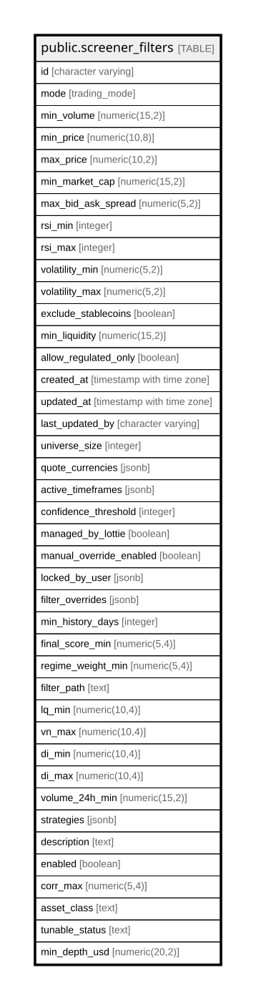

# public.screener_filters

## Columns

| Name | Type | Default | Nullable | Children | Parents | Comment |
| ---- | ---- | ------- | -------- | -------- | ------- | ------- |
| id | character varying | gen_random_uuid() | false |  |  |  |
| mode | trading_mode |  | false |  |  |  |
| min_volume | numeric(15,2) | 1000000.00 | true |  |  |  |
| min_price | numeric(10,8) | 0.01 | true |  |  |  |
| max_price | numeric(10,2) | 10000.00 | true |  |  |  |
| min_market_cap | numeric(15,2) | 100000000.00 | true |  |  |  |
| max_bid_ask_spread | numeric(5,2) | 1.00 | true |  |  |  |
| rsi_min | integer | 30 | true |  |  |  |
| rsi_max | integer | 70 | true |  |  |  |
| volatility_min | numeric(5,2) | 0.50 | true |  |  |  |
| volatility_max | numeric(5,2) | 5.00 | true |  |  |  |
| exclude_stablecoins | boolean | true | true |  |  |  |
| min_liquidity | numeric(15,2) | 500000.00 | true |  |  |  |
| allow_regulated_only | boolean | false | true |  |  |  |
| created_at | timestamp with time zone | now() | true |  |  |  |
| updated_at | timestamp with time zone | now() | true |  |  |  |
| last_updated_by | character varying |  | true |  |  |  |
| universe_size | integer | 100 | true |  |  |  |
| quote_currencies | jsonb | '[]'::jsonb | true |  |  |  |
| active_timeframes | jsonb | '["5m", "15m", "1h"]'::jsonb | true |  |  |  |
| confidence_threshold | integer | 60 | true |  |  |  |
| managed_by_lottie | boolean | true | false |  |  |  |
| manual_override_enabled | boolean | false | false |  |  |  |
| locked_by_user | jsonb | '{}'::jsonb | true |  |  |  |
| filter_overrides | jsonb | '{}'::jsonb | true |  |  |  |
| min_history_days | integer | 30 | true |  |  |  |
| final_score_min | numeric(5,4) | 0.35 | true |  |  |  |
| regime_weight_min | numeric(5,4) | 0.30 | true |  |  |  |
| filter_path | text |  | true |  |  |  |
| lq_min | numeric(10,4) |  | true |  |  |  |
| vn_max | numeric(10,4) |  | true |  |  |  |
| di_min | numeric(10,4) |  | true |  |  |  |
| di_max | numeric(10,4) |  | true |  |  |  |
| volume_24h_min | numeric(15,2) |  | true |  |  |  |
| strategies | jsonb |  | true |  |  |  |
| description | text |  | true |  |  |  |
| enabled | boolean | true | true |  |  |  |
| corr_max | numeric(5,4) | 0.9200 | true |  |  |  |
| asset_class | text | 'crypto_spot'::text | false |  |  |  |
| tunable_status | text | 'active'::text | false |  |  |  |
| min_depth_usd | numeric(20,2) |  | true |  |  | B.1.5: minimum two-way top-of-book depth (USD) required for filter admission. Gate fires on MIN(askDepthUsd, bidDepthUsd) computed from the scanner's rolling-median ~20-min window. NULL → gate skipped (graceful default). Seeded for xstock_spot only; crypto_spot uses volume-based LQ. |

## Viewpoints

| Name | Definition |
| ---- | ---------- |
| [public schema](viewpoint-schema-public.md) | All mapped relations in public. |

## Constraints

| Name | Type | Definition |
| ---- | ---- | ---------- |
| screener_filters_pkey | PRIMARY KEY | PRIMARY KEY (id) |

## Indexes

| Name | Definition |
| ---- | ---------- |
| idx_screener_filters_asset_class_mode | CREATE INDEX idx_screener_filters_asset_class_mode ON public.screener_filters USING btree (asset_class, mode) |
| screener_filters_mode_class_path_idx | CREATE UNIQUE INDEX screener_filters_mode_class_path_idx ON public.screener_filters USING btree (mode, asset_class, filter_path) |
| screener_filters_pkey | CREATE UNIQUE INDEX screener_filters_pkey ON public.screener_filters USING btree (id) |

## Relations

---

> Generated by [tbls](https://github.com/k1LoW/tbls)
