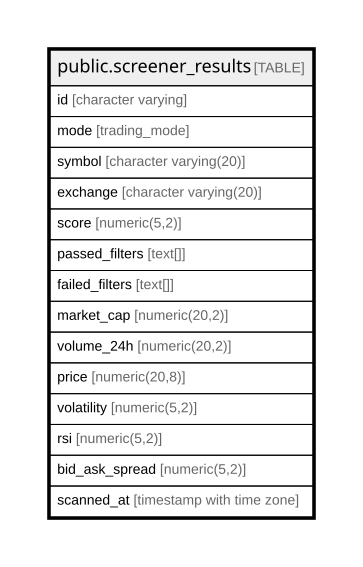

# public.screener_results

## Columns

| Name | Type | Default | Nullable | Children | Parents | Comment |
| ---- | ---- | ------- | -------- | -------- | ------- | ------- |
| id | character varying | gen_random_uuid() | false |  |  |  |
| mode | trading_mode |  | false |  |  |  |
| symbol | character varying(20) |  | false |  |  |  |
| exchange | character varying(20) | 'kraken'::character varying | true |  |  |  |
| score | numeric(5,2) |  | true |  |  |  |
| passed_filters | text[] | ARRAY[]::text[] | true |  |  |  |
| failed_filters | text[] | ARRAY[]::text[] | true |  |  |  |
| market_cap | numeric(20,2) |  | true |  |  |  |
| volume_24h | numeric(20,2) |  | true |  |  |  |
| price | numeric(20,8) |  | true |  |  |  |
| volatility | numeric(5,2) |  | true |  |  |  |
| rsi | numeric(5,2) |  | true |  |  |  |
| bid_ask_spread | numeric(5,2) |  | true |  |  |  |
| scanned_at | timestamp with time zone | now() | true |  |  |  |

## Viewpoints

| Name | Definition |
| ---- | ---------- |
| [public schema](viewpoint-schema-public.md) | All mapped relations in public. |

## Constraints

| Name | Type | Definition |
| ---- | ---- | ---------- |
| screener_results_pkey | PRIMARY KEY | PRIMARY KEY (id) |

## Indexes

| Name | Definition |
| ---- | ---------- |
| screener_results_pkey | CREATE UNIQUE INDEX screener_results_pkey ON public.screener_results USING btree (id) |

## Relations

---

> Generated by [tbls](https://github.com/k1LoW/tbls)
