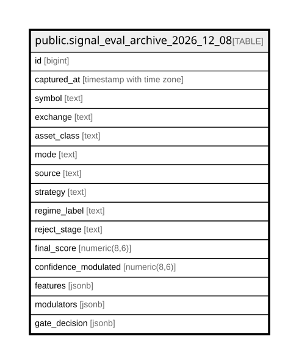

# public.signal_eval_archive_2026_12_08

## Columns

| Name | Type | Default | Nullable | Children | Parents | Comment |
| ---- | ---- | ------- | -------- | -------- | ------- | ------- |
| id | bigint | nextval('signal_eval_archive_id_seq'::regclass) | false |  |  |  |
| captured_at | timestamp with time zone | now() | false |  |  |  |
| symbol | text |  | false |  |  |  |
| exchange | text |  | false |  |  |  |
| asset_class | text |  | false |  |  |  |
| mode | text |  | false |  |  |  |
| source | text |  | false |  |  |  |
| strategy | text |  | false |  |  |  |
| regime_label | text |  | true |  |  |  |
| reject_stage | text |  | false |  |  |  |
| final_score | numeric(8,6) |  | true |  |  |  |
| confidence_modulated | numeric(8,6) |  | true |  |  |  |
| features | jsonb | '{"schema_version": 1}'::jsonb | false |  |  |  |
| modulators | jsonb | '{"schema_version": 1}'::jsonb | false |  |  |  |
| gate_decision | jsonb | '{"schema_version": 1}'::jsonb | false |  |  |  |

## Viewpoints

| Name | Definition |
| ---- | ---------- |
| [public schema](viewpoint-schema-public.md) | All mapped relations in public. |

## Constraints

| Name | Type | Definition |
| ---- | ---- | ---------- |
| signal_eval_archive_2026_12_08_pkey | PRIMARY KEY | PRIMARY KEY (captured_at, symbol, strategy, id) |

## Indexes

| Name | Definition |
| ---- | ---------- |
| signal_eval_archive_2026_12_08_asset_class_captured_at_idx | CREATE INDEX signal_eval_archive_2026_12_08_asset_class_captured_at_idx ON public.signal_eval_archive_2026_12_08 USING btree (asset_class, captured_at DESC) |
| signal_eval_archive_2026_12_08_mode_captured_at_idx | CREATE INDEX signal_eval_archive_2026_12_08_mode_captured_at_idx ON public.signal_eval_archive_2026_12_08 USING btree (mode, captured_at DESC) |
| signal_eval_archive_2026_12_08_pkey | CREATE UNIQUE INDEX signal_eval_archive_2026_12_08_pkey ON public.signal_eval_archive_2026_12_08 USING btree (captured_at, symbol, strategy, id) |
| signal_eval_archive_2026_12_08_reject_stage_captured_at_idx | CREATE INDEX signal_eval_archive_2026_12_08_reject_stage_captured_at_idx ON public.signal_eval_archive_2026_12_08 USING btree (reject_stage, captured_at DESC) |
| signal_eval_archive_2026_12_08_symbol_strategy_captured_at_idx | CREATE INDEX signal_eval_archive_2026_12_08_symbol_strategy_captured_at_idx ON public.signal_eval_archive_2026_12_08 USING btree (symbol, strategy, captured_at DESC) |

## Relations

---

> Generated by [tbls](https://github.com/k1LoW/tbls)
