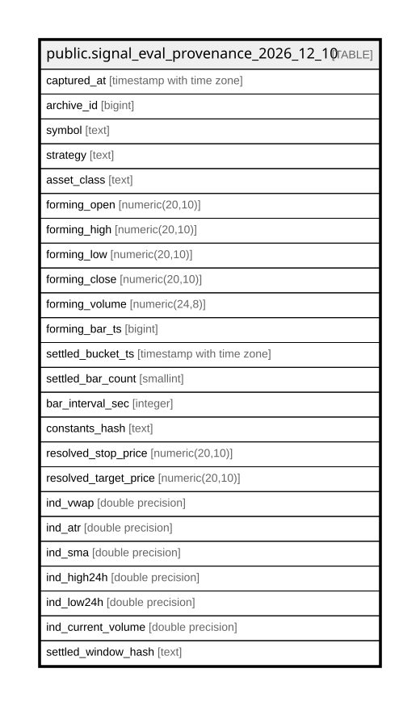

# public.signal_eval_provenance_2026_12_10

## Columns

| Name | Type | Default | Nullable | Children | Parents | Comment |
| ---- | ---- | ------- | -------- | -------- | ------- | ------- |
| captured_at | timestamp with time zone |  | false |  |  |  |
| archive_id | bigint |  | false |  |  |  |
| symbol | text |  | false |  |  |  |
| strategy | text |  | false |  |  |  |
| asset_class | text |  | false |  |  |  |
| forming_open | numeric(20,10) |  | true |  |  |  |
| forming_high | numeric(20,10) |  | true |  |  |  |
| forming_low | numeric(20,10) |  | true |  |  |  |
| forming_close | numeric(20,10) |  | true |  |  |  |
| forming_volume | numeric(24,8) |  | true |  |  |  |
| forming_bar_ts | bigint |  | true |  |  |  |
| settled_bucket_ts | timestamp with time zone |  | true |  |  |  |
| settled_bar_count | smallint |  | true |  |  |  |
| bar_interval_sec | integer |  | true |  |  |  |
| constants_hash | text |  | true |  |  |  |
| resolved_stop_price | numeric(20,10) |  | true |  |  |  |
| resolved_target_price | numeric(20,10) |  | true |  |  |  |
| ind_vwap | double precision |  | true |  |  |  |
| ind_atr | double precision |  | true |  |  |  |
| ind_sma | double precision |  | true |  |  |  |
| ind_high24h | double precision |  | true |  |  |  |
| ind_low24h | double precision |  | true |  |  |  |
| ind_current_volume | double precision |  | true |  |  |  |
| settled_window_hash | text |  | true |  |  |  |

## Viewpoints

| Name | Definition |
| ---- | ---------- |
| [public schema](viewpoint-schema-public.md) | All mapped relations in public. |

## Constraints

| Name | Type | Definition |
| ---- | ---- | ---------- |
| signal_eval_provenance_2026_12_10_pkey | PRIMARY KEY | PRIMARY KEY (captured_at, archive_id) |

## Indexes

| Name | Definition |
| ---- | ---------- |
| signal_eval_provenance_2026_12_10_pkey | CREATE UNIQUE INDEX signal_eval_provenance_2026_12_10_pkey ON public.signal_eval_provenance_2026_12_10 USING btree (captured_at, archive_id) |

## Relations

---

> Generated by [tbls](https://github.com/k1LoW/tbls)
