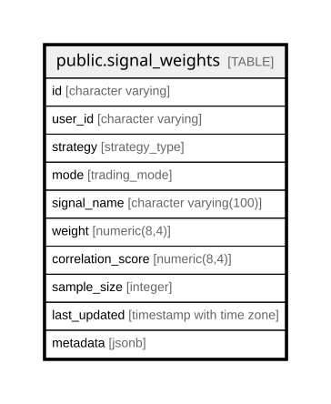

# public.signal_weights

## Columns

| Name | Type | Default | Nullable | Children | Parents | Comment |
| ---- | ---- | ------- | -------- | -------- | ------- | ------- |
| id | character varying | gen_random_uuid() | false |  |  |  |
| user_id | character varying |  | false |  |  |  |
| strategy | strategy_type |  | false |  |  |  |
| mode | trading_mode |  | false |  |  |  |
| signal_name | character varying(100) |  | false |  |  |  |
| weight | numeric(8,4) | 1.0000 | true |  |  |  |
| correlation_score | numeric(8,4) |  | true |  |  |  |
| sample_size | integer | 0 | true |  |  |  |
| last_updated | timestamp with time zone | now() | true |  |  |  |
| metadata | jsonb |  | true |  |  |  |

## Viewpoints

| Name | Definition |
| ---- | ---------- |
| [public schema](viewpoint-schema-public.md) | All mapped relations in public. |

## Constraints

| Name | Type | Definition |
| ---- | ---- | ---------- |
| signal_weights_pkey | PRIMARY KEY | PRIMARY KEY (id) |

## Indexes

| Name | Definition |
| ---- | ---------- |
| signal_weights_pkey | CREATE UNIQUE INDEX signal_weights_pkey ON public.signal_weights USING btree (id) |

## Relations

---

> Generated by [tbls](https://github.com/k1LoW/tbls)
