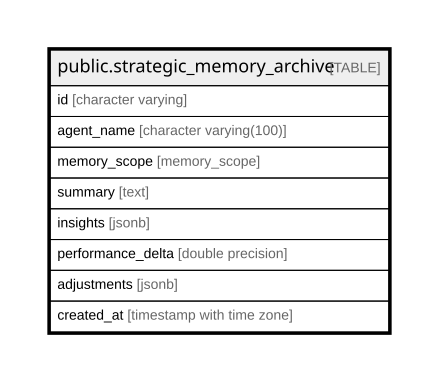

# public.strategic_memory_archive

## Columns

| Name | Type | Default | Nullable | Children | Parents | Comment |
| ---- | ---- | ------- | -------- | -------- | ------- | ------- |
| id | character varying | gen_random_uuid() | false |  |  |  |
| agent_name | character varying(100) |  | false |  |  |  |
| memory_scope | memory_scope |  | false |  |  |  |
| summary | text |  | false |  |  |  |
| insights | jsonb |  | false |  |  |  |
| performance_delta | double precision |  | true |  |  |  |
| adjustments | jsonb |  | true |  |  |  |
| created_at | timestamp with time zone | now() | false |  |  |  |

## Viewpoints

| Name | Definition |
| ---- | ---------- |
| [public schema](viewpoint-schema-public.md) | All mapped relations in public. |

## Constraints

| Name | Type | Definition |
| ---- | ---- | ---------- |
| strategic_memory_archive_pkey | PRIMARY KEY | PRIMARY KEY (id) |

## Indexes

| Name | Definition |
| ---- | ---------- |
| strategic_memory_archive_agent_name_idx | CREATE INDEX strategic_memory_archive_agent_name_idx ON public.strategic_memory_archive USING btree (agent_name) |
| strategic_memory_archive_created_at_idx | CREATE INDEX strategic_memory_archive_created_at_idx ON public.strategic_memory_archive USING btree (created_at) |
| strategic_memory_archive_memory_scope_idx | CREATE INDEX strategic_memory_archive_memory_scope_idx ON public.strategic_memory_archive USING btree (memory_scope) |
| strategic_memory_archive_pkey | CREATE UNIQUE INDEX strategic_memory_archive_pkey ON public.strategic_memory_archive USING btree (id) |

## Relations

---

> Generated by [tbls](https://github.com/k1LoW/tbls)
