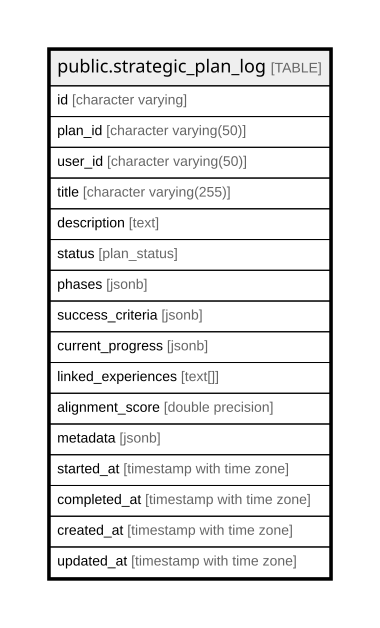

# public.strategic_plan_log

## Columns

| Name | Type | Default | Nullable | Children | Parents | Comment |
| ---- | ---- | ------- | -------- | -------- | ------- | ------- |
| id | character varying | gen_random_uuid() | false |  |  |  |
| plan_id | character varying(50) |  | false |  |  |  |
| user_id | character varying(50) |  | true |  |  |  |
| title | character varying(255) |  | false |  |  |  |
| description | text |  | true |  |  |  |
| status | plan_status | 'draft'::plan_status | false |  |  |  |
| phases | jsonb |  | false |  |  |  |
| success_criteria | jsonb |  | false |  |  |  |
| current_progress | jsonb | '{}'::jsonb | false |  |  |  |
| linked_experiences | text[] | ARRAY[]::text[] | true |  |  |  |
| alignment_score | double precision | 0 | true |  |  |  |
| metadata | jsonb |  | true |  |  |  |
| started_at | timestamp with time zone |  | true |  |  |  |
| completed_at | timestamp with time zone |  | true |  |  |  |
| created_at | timestamp with time zone | now() | false |  |  |  |
| updated_at | timestamp with time zone | now() | false |  |  |  |

## Viewpoints

| Name | Definition |
| ---- | ---------- |
| [public schema](viewpoint-schema-public.md) | All mapped relations in public. |

## Constraints

| Name | Type | Definition |
| ---- | ---- | ---------- |
| strategic_plan_log_pkey | PRIMARY KEY | PRIMARY KEY (id) |
| strategic_plan_log_plan_id_unique | UNIQUE | UNIQUE (plan_id) |

## Indexes

| Name | Definition |
| ---- | ---------- |
| strategic_plan_log_pkey | CREATE UNIQUE INDEX strategic_plan_log_pkey ON public.strategic_plan_log USING btree (id) |
| strategic_plan_log_plan_id_idx | CREATE INDEX strategic_plan_log_plan_id_idx ON public.strategic_plan_log USING btree (plan_id) |
| strategic_plan_log_plan_id_unique | CREATE UNIQUE INDEX strategic_plan_log_plan_id_unique ON public.strategic_plan_log USING btree (plan_id) |
| strategic_plan_log_status_idx | CREATE INDEX strategic_plan_log_status_idx ON public.strategic_plan_log USING btree (status) |
| strategic_plan_log_user_id_idx | CREATE INDEX strategic_plan_log_user_id_idx ON public.strategic_plan_log USING btree (user_id) |

## Relations

---

> Generated by [tbls](https://github.com/k1LoW/tbls)
