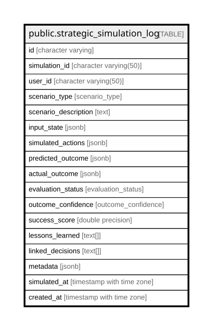

# public.strategic_simulation_log

## Columns

| Name | Type | Default | Nullable | Children | Parents | Comment |
| ---- | ---- | ------- | -------- | -------- | ------- | ------- |
| id | character varying | gen_random_uuid() | false |  |  |  |
| simulation_id | character varying(50) |  | false |  |  |  |
| user_id | character varying(50) |  | true |  |  |  |
| scenario_type | scenario_type |  | false |  |  |  |
| scenario_description | text |  | false |  |  |  |
| input_state | jsonb |  | false |  |  |  |
| simulated_actions | jsonb |  | false |  |  |  |
| predicted_outcome | jsonb |  | false |  |  |  |
| actual_outcome | jsonb |  | true |  |  |  |
| evaluation_status | evaluation_status | 'pending'::evaluation_status | false |  |  |  |
| outcome_confidence | outcome_confidence | 'medium'::outcome_confidence | false |  |  |  |
| success_score | double precision |  | true |  |  |  |
| lessons_learned | text[] | ARRAY[]::text[] | true |  |  |  |
| linked_decisions | text[] | ARRAY[]::text[] | true |  |  |  |
| metadata | jsonb |  | true |  |  |  |
| simulated_at | timestamp with time zone | now() | false |  |  |  |
| created_at | timestamp with time zone | now() | false |  |  |  |

## Viewpoints

| Name | Definition |
| ---- | ---------- |
| [public schema](viewpoint-schema-public.md) | All mapped relations in public. |

## Constraints

| Name | Type | Definition |
| ---- | ---- | ---------- |
| strategic_simulation_log_pkey | PRIMARY KEY | PRIMARY KEY (id) |
| strategic_simulation_log_simulation_id_key | UNIQUE | UNIQUE (simulation_id) |

## Indexes

| Name | Definition |
| ---- | ---------- |
| strategic_simulation_log_evaluation_status_idx | CREATE INDEX strategic_simulation_log_evaluation_status_idx ON public.strategic_simulation_log USING btree (evaluation_status) |
| strategic_simulation_log_pkey | CREATE UNIQUE INDEX strategic_simulation_log_pkey ON public.strategic_simulation_log USING btree (id) |
| strategic_simulation_log_scenario_type_idx | CREATE INDEX strategic_simulation_log_scenario_type_idx ON public.strategic_simulation_log USING btree (scenario_type) |
| strategic_simulation_log_simulation_id_idx | CREATE INDEX strategic_simulation_log_simulation_id_idx ON public.strategic_simulation_log USING btree (simulation_id) |
| strategic_simulation_log_simulation_id_key | CREATE UNIQUE INDEX strategic_simulation_log_simulation_id_key ON public.strategic_simulation_log USING btree (simulation_id) |
| strategic_simulation_log_user_id_idx | CREATE INDEX strategic_simulation_log_user_id_idx ON public.strategic_simulation_log USING btree (user_id) |

## Relations

---

> Generated by [tbls](https://github.com/k1LoW/tbls)
