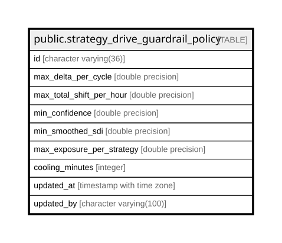

# public.strategy_drive_guardrail_policy

## Columns

| Name | Type | Default | Nullable | Children | Parents | Comment |
| ---- | ---- | ------- | -------- | -------- | ------- | ------- |
| id | character varying(36) | gen_random_uuid() | false |  |  |  |
| max_delta_per_cycle | double precision | 0.15 | false |  |  |  |
| max_total_shift_per_hour | double precision | 0.40 | false |  |  |  |
| min_confidence | double precision | 0.50 | false |  |  |  |
| min_smoothed_sdi | double precision | 0.45 | false |  |  |  |
| max_exposure_per_strategy | double precision | 0.50 | false |  |  |  |
| cooling_minutes | integer | 20 | false |  |  |  |
| updated_at | timestamp with time zone | now() | false |  |  |  |
| updated_by | character varying(100) |  | true |  |  |  |

## Viewpoints

| Name | Definition |
| ---- | ---------- |
| [public schema](viewpoint-schema-public.md) | All mapped relations in public. |

## Constraints

| Name | Type | Definition |
| ---- | ---- | ---------- |
| strategy_drive_guardrail_policy_pkey | PRIMARY KEY | PRIMARY KEY (id) |

## Indexes

| Name | Definition |
| ---- | ---------- |
| strategy_drive_guardrail_policy_pkey | CREATE UNIQUE INDEX strategy_drive_guardrail_policy_pkey ON public.strategy_drive_guardrail_policy USING btree (id) |

## Relations

---

> Generated by [tbls](https://github.com/k1LoW/tbls)
