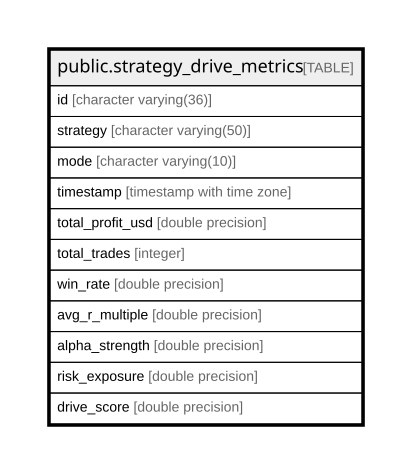

# public.strategy_drive_metrics

## Columns

| Name | Type | Default | Nullable | Children | Parents | Comment |
| ---- | ---- | ------- | -------- | -------- | ------- | ------- |
| id | character varying(36) | gen_random_uuid() | false |  |  |  |
| strategy | character varying(50) |  | false |  |  |  |
| mode | character varying(10) |  | false |  |  |  |
| timestamp | timestamp with time zone | now() | false |  |  |  |
| total_profit_usd | double precision | 0 | false |  |  |  |
| total_trades | integer | 0 | false |  |  |  |
| win_rate | double precision | 0 | false |  |  |  |
| avg_r_multiple | double precision | 0 | false |  |  |  |
| alpha_strength | double precision | 0 | false |  |  |  |
| risk_exposure | double precision | 0 | false |  |  |  |
| drive_score | double precision | 0 | false |  |  |  |

## Viewpoints

| Name | Definition |
| ---- | ---------- |
| [public schema](viewpoint-schema-public.md) | All mapped relations in public. |

## Constraints

| Name | Type | Definition |
| ---- | ---- | ---------- |
| strategy_drive_metrics_pkey | PRIMARY KEY | PRIMARY KEY (id) |

## Indexes

| Name | Definition |
| ---- | ---------- |
| strategy_drive_metrics_mode_idx | CREATE INDEX strategy_drive_metrics_mode_idx ON public.strategy_drive_metrics USING btree (mode) |
| strategy_drive_metrics_pkey | CREATE UNIQUE INDEX strategy_drive_metrics_pkey ON public.strategy_drive_metrics USING btree (id) |
| strategy_drive_metrics_strategy_idx | CREATE INDEX strategy_drive_metrics_strategy_idx ON public.strategy_drive_metrics USING btree (strategy) |
| strategy_drive_metrics_timestamp_idx | CREATE INDEX strategy_drive_metrics_timestamp_idx ON public.strategy_drive_metrics USING btree ("timestamp") |

## Relations

---

> Generated by [tbls](https://github.com/k1LoW/tbls)
