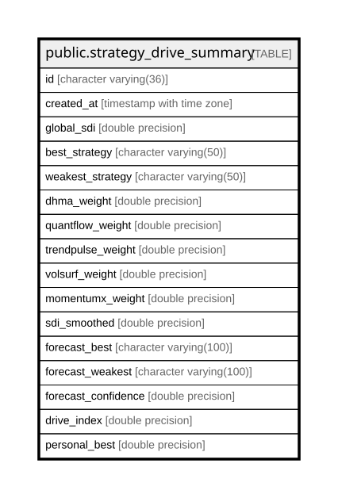

# public.strategy_drive_summary

## Columns

| Name | Type | Default | Nullable | Children | Parents | Comment |
| ---- | ---- | ------- | -------- | -------- | ------- | ------- |
| id | character varying(36) | gen_random_uuid() | false |  |  |  |
| created_at | timestamp with time zone | now() | false |  |  |  |
| global_sdi | double precision |  | false |  |  |  |
| best_strategy | character varying(50) |  | false |  |  |  |
| weakest_strategy | character varying(50) |  | false |  |  |  |
| dhma_weight | double precision | 1 | false |  |  |  |
| quantflow_weight | double precision | 1 | false |  |  |  |
| trendpulse_weight | double precision | 1 | false |  |  |  |
| volsurf_weight | double precision | 1 | false |  |  |  |
| momentumx_weight | double precision | 1 | false |  |  |  |
| sdi_smoothed | double precision | 0 | false |  |  |  |
| forecast_best | character varying(100) |  | true |  |  |  |
| forecast_weakest | character varying(100) |  | true |  |  |  |
| forecast_confidence | double precision | 0 | false |  |  |  |
| drive_index | double precision | 0.5 | true |  |  |  |
| personal_best | double precision | 0.0 | true |  |  |  |

## Viewpoints

| Name | Definition |
| ---- | ---------- |
| [public schema](viewpoint-schema-public.md) | All mapped relations in public. |

## Constraints

| Name | Type | Definition |
| ---- | ---- | ---------- |
| strategy_drive_summary_pkey | PRIMARY KEY | PRIMARY KEY (id) |

## Indexes

| Name | Definition |
| ---- | ---------- |
| strategy_drive_summary_created_at_idx | CREATE INDEX strategy_drive_summary_created_at_idx ON public.strategy_drive_summary USING btree (created_at) |
| strategy_drive_summary_pkey | CREATE UNIQUE INDEX strategy_drive_summary_pkey ON public.strategy_drive_summary USING btree (id) |

## Relations

---

> Generated by [tbls](https://github.com/k1LoW/tbls)
