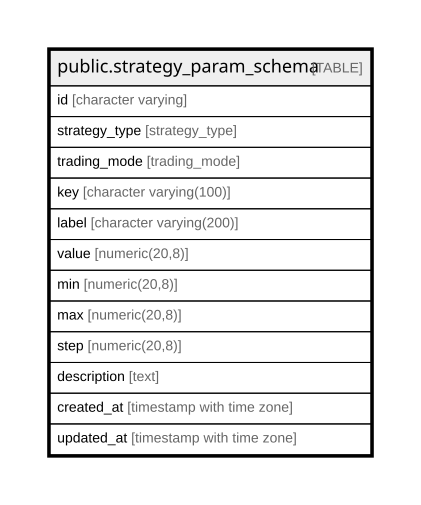

# public.strategy_param_schema

## Columns

| Name | Type | Default | Nullable | Children | Parents | Comment |
| ---- | ---- | ------- | -------- | -------- | ------- | ------- |
| id | character varying | gen_random_uuid() | false |  |  |  |
| strategy_type | strategy_type |  | false |  |  |  |
| trading_mode | trading_mode |  | false |  |  |  |
| key | character varying(100) |  | false |  |  |  |
| label | character varying(200) |  | false |  |  |  |
| value | numeric(20,8) |  | false |  |  |  |
| min | numeric(20,8) |  | false |  |  |  |
| max | numeric(20,8) |  | false |  |  |  |
| step | numeric(20,8) |  | false |  |  |  |
| description | text |  | true |  |  |  |
| created_at | timestamp with time zone | now() | true |  |  |  |
| updated_at | timestamp with time zone | now() | true |  |  |  |

## Viewpoints

| Name | Definition |
| ---- | ---------- |
| [public schema](viewpoint-schema-public.md) | All mapped relations in public. |

## Constraints

| Name | Type | Definition |
| ---- | ---- | ---------- |
| strategy_param_schema_pkey | PRIMARY KEY | PRIMARY KEY (id) |

## Indexes

| Name | Definition |
| ---- | ---------- |
| strategy_param_schema_pkey | CREATE UNIQUE INDEX strategy_param_schema_pkey ON public.strategy_param_schema USING btree (id) |
| strategy_param_schema_strategy_mode_key_idx | CREATE UNIQUE INDEX strategy_param_schema_strategy_mode_key_idx ON public.strategy_param_schema USING btree (strategy_type, trading_mode, key) |

## Relations

---

> Generated by [tbls](https://github.com/k1LoW/tbls)
