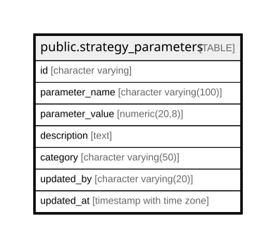

# public.strategy_parameters

## Columns

| Name | Type | Default | Nullable | Children | Parents | Comment |
| ---- | ---- | ------- | -------- | -------- | ------- | ------- |
| id | character varying | gen_random_uuid() | false |  |  |  |
| parameter_name | character varying(100) |  | false |  |  |  |
| parameter_value | numeric(20,8) |  | false |  |  |  |
| description | text |  | true |  |  |  |
| category | character varying(50) |  | true |  |  |  |
| updated_by | character varying(20) | 'user'::character varying | true |  |  |  |
| updated_at | timestamp with time zone | now() | true |  |  |  |

## Viewpoints

| Name | Definition |
| ---- | ---------- |
| [public schema](viewpoint-schema-public.md) | All mapped relations in public. |

## Constraints

| Name | Type | Definition |
| ---- | ---- | ---------- |
| strategy_parameters_pkey | PRIMARY KEY | PRIMARY KEY (id) |

## Indexes

| Name | Definition |
| ---- | ---------- |
| strategy_parameters_pkey | CREATE UNIQUE INDEX strategy_parameters_pkey ON public.strategy_parameters USING btree (id) |

## Relations

---

> Generated by [tbls](https://github.com/k1LoW/tbls)
