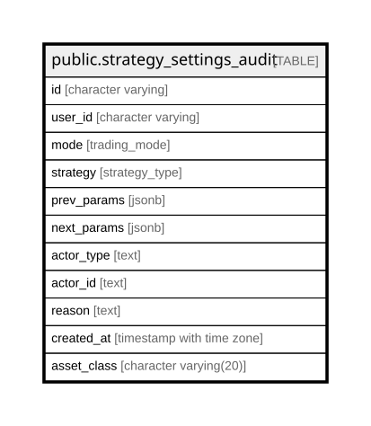

# public.strategy_settings_audit

## Columns

| Name | Type | Default | Nullable | Children | Parents | Comment |
| ---- | ---- | ------- | -------- | -------- | ------- | ------- |
| id | character varying | gen_random_uuid() | false |  |  |  |
| user_id | character varying |  | false |  |  |  |
| mode | trading_mode |  | false |  |  |  |
| strategy | strategy_type |  | false |  |  |  |
| prev_params | jsonb |  | true |  |  |  |
| next_params | jsonb |  | false |  |  |  |
| actor_type | text |  | false |  |  |  |
| actor_id | text |  | true |  |  |  |
| reason | text |  | true |  |  |  |
| created_at | timestamp with time zone | now() | true |  |  |  |
| asset_class | character varying(20) |  | false |  |  |  |

## Viewpoints

| Name | Definition |
| ---- | ---------- |
| [public schema](viewpoint-schema-public.md) | All mapped relations in public. |

## Constraints

| Name | Type | Definition |
| ---- | ---- | ---------- |
| strategy_settings_audit_pkey | PRIMARY KEY | PRIMARY KEY (id) |

## Indexes

| Name | Definition |
| ---- | ---------- |
| strategy_settings_audit_pkey | CREATE UNIQUE INDEX strategy_settings_audit_pkey ON public.strategy_settings_audit USING btree (id) |

## Relations

---

> Generated by [tbls](https://github.com/k1LoW/tbls)
