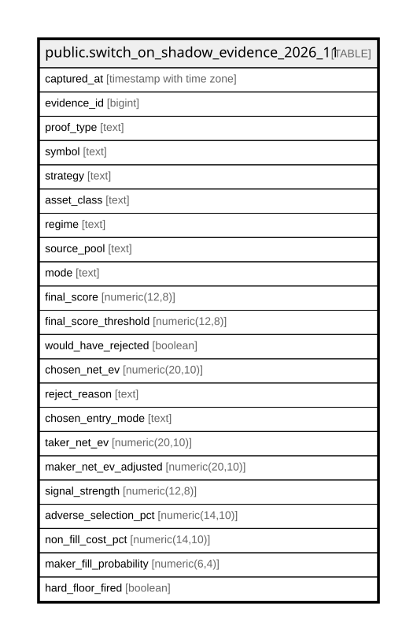

# public.switch_on_shadow_evidence_2026_11

## Columns

| Name | Type | Default | Nullable | Children | Parents | Comment |
| ---- | ---- | ------- | -------- | -------- | ------- | ------- |
| captured_at | timestamp with time zone |  | false |  |  |  |
| evidence_id | bigint | nextval('switch_on_shadow_evidence_id_seq'::regclass) | false |  |  |  |
| proof_type | text |  | false |  |  |  |
| symbol | text |  | false |  |  |  |
| strategy | text |  | false |  |  |  |
| asset_class | text |  | false |  |  |  |
| regime | text |  | true |  |  |  |
| source_pool | text |  | true |  |  |  |
| mode | text |  | false |  |  |  |
| final_score | numeric(12,8) |  | true |  |  |  |
| final_score_threshold | numeric(12,8) |  | true |  |  |  |
| would_have_rejected | boolean |  | true |  |  |  |
| chosen_net_ev | numeric(20,10) |  | true |  |  |  |
| reject_reason | text |  | true |  |  |  |
| chosen_entry_mode | text |  | true |  |  |  |
| taker_net_ev | numeric(20,10) |  | true |  |  |  |
| maker_net_ev_adjusted | numeric(20,10) |  | true |  |  |  |
| signal_strength | numeric(12,8) |  | true |  |  |  |
| adverse_selection_pct | numeric(14,10) |  | true |  |  |  |
| non_fill_cost_pct | numeric(14,10) |  | true |  |  |  |
| maker_fill_probability | numeric(6,4) |  | true |  |  |  |
| hard_floor_fired | boolean |  | true |  |  |  |

## Viewpoints

| Name | Definition |
| ---- | ---------- |
| [public schema](viewpoint-schema-public.md) | All mapped relations in public. |

## Constraints

| Name | Type | Definition |
| ---- | ---- | ---------- |
| switch_on_shadow_evidence_2026_11_pkey | PRIMARY KEY | PRIMARY KEY (captured_at, evidence_id) |

## Indexes

| Name | Definition |
| ---- | ---------- |
| switch_on_shadow_evidence_2026_11_pkey | CREATE UNIQUE INDEX switch_on_shadow_evidence_2026_11_pkey ON public.switch_on_shadow_evidence_2026_11 USING btree (captured_at, evidence_id) |
| switch_on_shadow_evidence_2026_11_proof_type_captured_at_idx | CREATE INDEX switch_on_shadow_evidence_2026_11_proof_type_captured_at_idx ON public.switch_on_shadow_evidence_2026_11 USING btree (proof_type, captured_at) |

## Relations

---

> Generated by [tbls](https://github.com/k1LoW/tbls)
