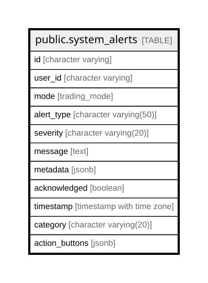

# public.system_alerts

## Columns

| Name | Type | Default | Nullable | Children | Parents | Comment |
| ---- | ---- | ------- | -------- | -------- | ------- | ------- |
| id | character varying | gen_random_uuid() | false |  |  |  |
| user_id | character varying |  | false |  |  |  |
| mode | trading_mode |  | false |  |  |  |
| alert_type | character varying(50) |  | false |  |  |  |
| severity | character varying(20) | 'info'::character varying | true |  |  |  |
| message | text |  | false |  |  |  |
| metadata | jsonb |  | true |  |  |  |
| acknowledged | boolean | false | true |  |  |  |
| timestamp | timestamp with time zone | now() | true |  |  |  |
| category | character varying(20) | 'informational'::character varying | true |  |  |  |
| action_buttons | jsonb |  | true |  |  |  |

## Viewpoints

| Name | Definition |
| ---- | ---------- |
| [public schema](viewpoint-schema-public.md) | All mapped relations in public. |

## Constraints

| Name | Type | Definition |
| ---- | ---- | ---------- |
| system_alerts_pkey | PRIMARY KEY | PRIMARY KEY (id) |
| unique_global_alert | UNIQUE | UNIQUE (mode, alert_type, message) |

## Indexes

| Name | Definition |
| ---- | ---------- |
| system_alerts_pkey | CREATE UNIQUE INDEX system_alerts_pkey ON public.system_alerts USING btree (id) |
| system_alerts_user_mode_timestamp_idx | CREATE UNIQUE INDEX system_alerts_user_mode_timestamp_idx ON public.system_alerts USING btree (user_id, mode, "timestamp") |
| unique_global_alert | CREATE UNIQUE INDEX unique_global_alert ON public.system_alerts USING btree (mode, alert_type, message) |

## Relations

---

> Generated by [tbls](https://github.com/k1LoW/tbls)
