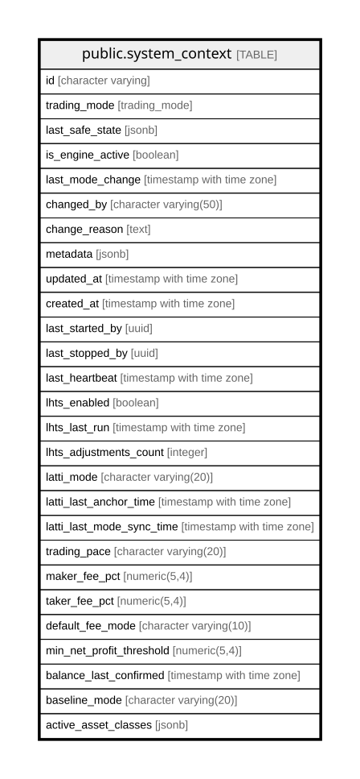

# public.system_context

## Columns

| Name | Type | Default | Nullable | Children | Parents | Comment |
| ---- | ---- | ------- | -------- | -------- | ------- | ------- |
| id | character varying | gen_random_uuid() | false |  |  |  |
| trading_mode | trading_mode | 'paper'::trading_mode | false |  |  |  |
| last_safe_state | jsonb | '{}'::jsonb | false |  |  |  |
| is_engine_active | boolean | false | false |  |  |  |
| last_mode_change | timestamp with time zone |  | true |  |  |  |
| changed_by | character varying(50) |  | true |  |  |  |
| change_reason | text |  | true |  |  |  |
| metadata | jsonb | '{}'::jsonb | true |  |  |  |
| updated_at | timestamp with time zone | now() | false |  |  |  |
| created_at | timestamp with time zone | now() | false |  |  |  |
| last_started_by | uuid |  | true |  |  |  |
| last_stopped_by | uuid |  | true |  |  |  |
| last_heartbeat | timestamp with time zone |  | true |  |  |  |
| lhts_enabled | boolean | false | true |  |  |  |
| lhts_last_run | timestamp with time zone |  | true |  |  |  |
| lhts_adjustments_count | integer | 0 | true |  |  |  |
| latti_mode | character varying(20) | 'paper'::character varying | true |  |  |  |
| latti_last_anchor_time | timestamp with time zone |  | true |  |  |  |
| latti_last_mode_sync_time | timestamp with time zone |  | true |  |  |  |
| trading_pace | character varying(20) | 'baseline'::character varying | true |  |  |  |
| maker_fee_pct | numeric(5,4) |  | true |  |  |  |
| taker_fee_pct | numeric(5,4) |  | true |  |  |  |
| default_fee_mode | character varying(10) | 'taker'::character varying | true |  |  |  |
| min_net_profit_threshold | numeric(5,4) | 0.0030 | true |  |  |  |
| balance_last_confirmed | timestamp with time zone |  | true |  |  |  |
| baseline_mode | character varying(20) | 'per_simulation'::character varying | true |  |  |  |
| active_asset_classes | jsonb | '{}'::jsonb | false |  |  |  |

## Viewpoints

| Name | Definition |
| ---- | ---------- |
| [public schema](viewpoint-schema-public.md) | All mapped relations in public. |

## Constraints

| Name | Type | Definition |
| ---- | ---- | ---------- |
| system_context_pkey | PRIMARY KEY | PRIMARY KEY (id) |

## Indexes

| Name | Definition |
| ---- | ---------- |
| system_context_last_mode_change_idx | CREATE INDEX system_context_last_mode_change_idx ON public.system_context USING btree (last_mode_change) |
| system_context_pkey | CREATE UNIQUE INDEX system_context_pkey ON public.system_context USING btree (id) |
| system_context_trading_mode_idx | CREATE INDEX system_context_trading_mode_idx ON public.system_context USING btree (trading_mode) |

## Relations

---

> Generated by [tbls](https://github.com/k1LoW/tbls)
