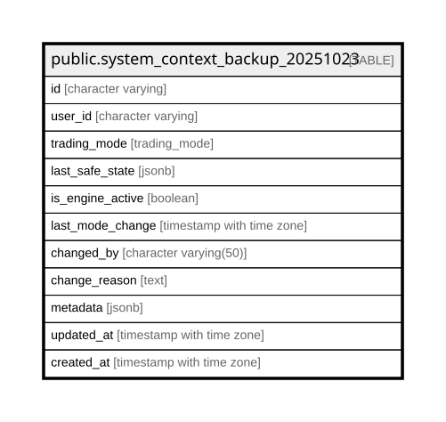

# public.system_context_backup_20251023

## Columns

| Name | Type | Default | Nullable | Children | Parents | Comment |
| ---- | ---- | ------- | -------- | -------- | ------- | ------- |
| id | character varying | gen_random_uuid() | false |  |  |  |
| user_id | character varying |  | false |  |  |  |
| trading_mode | trading_mode | 'paper'::trading_mode | false |  |  |  |
| last_safe_state | jsonb | '{}'::jsonb | false |  |  |  |
| is_engine_active | boolean | false | false |  |  |  |
| last_mode_change | timestamp with time zone |  | true |  |  |  |
| changed_by | character varying(50) |  | true |  |  |  |
| change_reason | text |  | true |  |  |  |
| metadata | jsonb | '{}'::jsonb | true |  |  |  |
| updated_at | timestamp with time zone | now() | false |  |  |  |
| created_at | timestamp with time zone | now() | false |  |  |  |

## Viewpoints

| Name | Definition |
| ---- | ---------- |
| [public schema](viewpoint-schema-public.md) | All mapped relations in public. |

## Constraints

| Name | Type | Definition |
| ---- | ---- | ---------- |
| system_context_backup_20251023_pkey | PRIMARY KEY | PRIMARY KEY (id) |
| system_context_backup_20251023_user_id_key | UNIQUE | UNIQUE (user_id) |

## Indexes

| Name | Definition |
| ---- | ---------- |
| system_context_backup_20251023_last_mode_change_idx | CREATE INDEX system_context_backup_20251023_last_mode_change_idx ON public.system_context_backup_20251023 USING btree (last_mode_change) |
| system_context_backup_20251023_pkey | CREATE UNIQUE INDEX system_context_backup_20251023_pkey ON public.system_context_backup_20251023 USING btree (id) |
| system_context_backup_20251023_trading_mode_idx | CREATE INDEX system_context_backup_20251023_trading_mode_idx ON public.system_context_backup_20251023 USING btree (trading_mode) |
| system_context_backup_20251023_user_id_idx | CREATE INDEX system_context_backup_20251023_user_id_idx ON public.system_context_backup_20251023 USING btree (user_id) |
| system_context_backup_20251023_user_id_key | CREATE UNIQUE INDEX system_context_backup_20251023_user_id_key ON public.system_context_backup_20251023 USING btree (user_id) |

## Relations

---

> Generated by [tbls](https://github.com/k1LoW/tbls)
