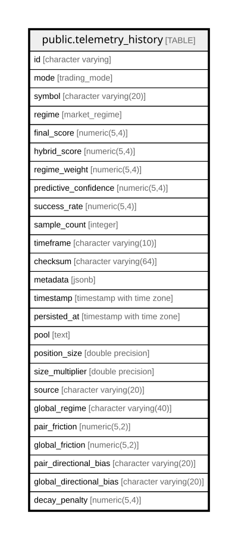

# public.telemetry_history

## Description

Directive 11.1A: SQL-backed telemetry persistence with market regime tagging

## Columns

| Name | Type | Default | Nullable | Children | Parents | Comment |
| ---- | ---- | ------- | -------- | -------- | ------- | ------- |
| id | character varying | gen_random_uuid() | false |  |  |  |
| mode | trading_mode |  | false |  |  |  |
| symbol | character varying(20) |  | false |  |  |  |
| regime | market_regime |  | false |  |  | Market regime at time of telemetry capture (ENUM) |
| final_score | numeric(5,4) |  | false |  |  |  |
| hybrid_score | numeric(5,4) |  | true |  |  |  |
| regime_weight | numeric(5,4) |  | true |  |  |  |
| predictive_confidence | numeric(5,4) |  | true |  |  |  |
| success_rate | numeric(5,4) |  | true |  |  |  |
| sample_count | integer | 1 | true |  |  |  |
| timeframe | character varying(10) |  | true |  |  |  |
| checksum | character varying(64) |  | true |  |  | SHA-256 checksum for integrity validation |
| metadata | jsonb |  | true |  |  |  |
| timestamp | timestamp with time zone | now() | false |  |  |  |
| persisted_at | timestamp with time zone | now() | false |  |  | Timestamp when record was persisted to database |
| pool | text | 'ideal'::text | true |  |  | Directive 11.2 R1: Source pool (ideal or rotational) for segmented performance tracking |
| position_size | double precision |  | true |  |  | Directive 11.3: DSE computed trade size |
| size_multiplier | double precision |  | true |  |  | Directive 11.3: DSE scaling multiplier (0.3-1.2) |
| source | character varying(20) | 'unknown'::character varying | true |  |  | Phase 14 telemetry source tag |
| global_regime | character varying(40) |  | true |  |  | Phase 14 global regime context |
| pair_friction | numeric(5,2) |  | true |  |  | Phase 14 pair friction context |
| global_friction | numeric(5,2) |  | true |  |  | Phase 14 global friction context |
| pair_directional_bias | character varying(20) |  | true |  |  | Phase 14 pair directional-bias context |
| global_directional_bias | character varying(20) |  | true |  |  | Phase 14 global directional-bias context |
| decay_penalty | numeric(5,4) |  | true |  |  | Phase 14 decay-penalty context |

## Viewpoints

| Name | Definition |
| ---- | ---------- |
| [public schema](viewpoint-schema-public.md) | All mapped relations in public. |

## Constraints

| Name | Type | Definition |
| ---- | ---- | ---------- |
| telemetry_history_pkey | PRIMARY KEY | PRIMARY KEY (id) |

## Indexes

| Name | Definition |
| ---- | ---------- |
| idx_telemetry_history_regime_pool | CREATE INDEX idx_telemetry_history_regime_pool ON public.telemetry_history USING btree (regime, pool) |
| telemetry_history_mode_timestamp_idx | CREATE INDEX telemetry_history_mode_timestamp_idx ON public.telemetry_history USING btree (mode, "timestamp") |
| telemetry_history_pkey | CREATE UNIQUE INDEX telemetry_history_pkey ON public.telemetry_history USING btree (id) |
| telemetry_history_regime_idx | CREATE INDEX telemetry_history_regime_idx ON public.telemetry_history USING btree (regime) |
| telemetry_history_symbol_idx | CREATE INDEX telemetry_history_symbol_idx ON public.telemetry_history USING btree (symbol) |

## Relations

---

> Generated by [tbls](https://github.com/k1LoW/tbls)
