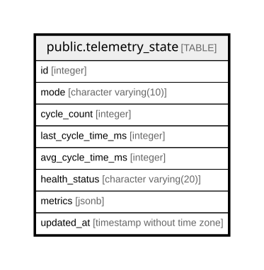

# public.telemetry_state

## Columns

| Name | Type | Default | Nullable | Children | Parents | Comment |
| ---- | ---- | ------- | -------- | -------- | ------- | ------- |
| id | integer | nextval('telemetry_state_id_seq'::regclass) | false |  |  |  |
| mode | character varying(10) |  | false |  |  |  |
| cycle_count | integer | 0 | true |  |  |  |
| last_cycle_time_ms | integer |  | true |  |  |  |
| avg_cycle_time_ms | integer |  | true |  |  |  |
| health_status | character varying(20) | 'healthy'::character varying | true |  |  |  |
| metrics | jsonb |  | true |  |  |  |
| updated_at | timestamp without time zone | now() | true |  |  |  |

## Viewpoints

| Name | Definition |
| ---- | ---------- |
| [public schema](viewpoint-schema-public.md) | All mapped relations in public. |

## Constraints

| Name | Type | Definition |
| ---- | ---- | ---------- |
| telemetry_state_pkey | PRIMARY KEY | PRIMARY KEY (id) |

## Indexes

| Name | Definition |
| ---- | ---------- |
| telemetry_state_pkey | CREATE UNIQUE INDEX telemetry_state_pkey ON public.telemetry_state USING btree (id) |

## Relations

---

> Generated by [tbls](https://github.com/k1LoW/tbls)
