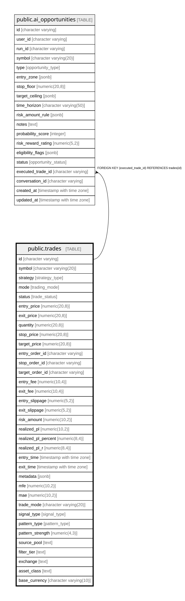

# public.trades

## Columns

| Name | Type | Default | Nullable | Children | Parents | Comment |
| ---- | ---- | ------- | -------- | -------- | ------- | ------- |
| id | character varying | gen_random_uuid() | false | [public.ai_opportunities](public.ai_opportunities.md) |  |  |
| symbol | character varying(20) |  | false |  |  |  |
| strategy | strategy_type |  | false |  |  |  |
| mode | trading_mode |  | false |  |  |  |
| status | trade_status | 'open'::trade_status | true |  |  |  |
| entry_price | numeric(20,8) |  | false |  |  |  |
| exit_price | numeric(20,8) |  | true |  |  |  |
| quantity | numeric(20,8) |  | false |  |  |  |
| stop_price | numeric(20,8) |  | false |  |  |  |
| target_price | numeric(20,8) |  | false |  |  |  |
| entry_order_id | character varying |  | true |  |  |  |
| stop_order_id | character varying |  | true |  |  |  |
| target_order_id | character varying |  | true |  |  |  |
| entry_fee | numeric(10,4) | '0'::numeric | true |  |  |  |
| exit_fee | numeric(10,4) | '0'::numeric | true |  |  |  |
| entry_slippage | numeric(5,2) | '0'::numeric | true |  |  |  |
| exit_slippage | numeric(5,2) | '0'::numeric | true |  |  |  |
| risk_amount | numeric(10,2) |  | false |  |  |  |
| realized_pl | numeric(10,2) |  | true |  |  |  |
| realized_pl_percent | numeric(8,4) |  | true |  |  |  |
| realized_pl_r | numeric(8,4) |  | true |  |  |  |
| entry_time | timestamp with time zone | now() | true |  |  |  |
| exit_time | timestamp with time zone |  | true |  |  |  |
| metadata | jsonb |  | true |  |  |  |
| mfe | numeric(10,2) |  | true |  |  |  |
| mae | numeric(10,2) |  | true |  |  |  |
| trade_mode | character varying(20) | 'TARGET'::character varying | true |  |  |  |
| signal_type | signal_type | 'QUANT'::signal_type | false |  |  |  |
| pattern_type | pattern_type |  | true |  |  |  |
| pattern_strength | numeric(4,3) |  | true |  |  |  |
| source_pool | text |  | true |  |  |  |
| filter_tier | text |  | true |  |  |  |
| exchange | text | 'kraken'::text | false |  |  |  |
| asset_class | text | 'crypto_spot'::text | false |  |  |  |
| base_currency | character varying(10) |  | false |  |  |  |

## Viewpoints

| Name | Definition |
| ---- | ---------- |
| [public schema](viewpoint-schema-public.md) | All mapped relations in public. |

## Constraints

| Name | Type | Definition |
| ---- | ---- | ---------- |
| trades_pkey | PRIMARY KEY | PRIMARY KEY (id) |

## Indexes

| Name | Definition |
| ---- | ---------- |
| idx_trades_mode_status | CREATE INDEX idx_trades_mode_status ON public.trades USING btree (mode, status) |
| idx_trades_mode_status_exit_time | CREATE INDEX idx_trades_mode_status_exit_time ON public.trades USING btree (mode, status, exit_time) |
| idx_trades_symbol_mode | CREATE INDEX idx_trades_symbol_mode ON public.trades USING btree (symbol, mode) |
| trades_pkey | CREATE UNIQUE INDEX trades_pkey ON public.trades USING btree (id) |

## Relations

---

> Generated by [tbls](https://github.com/k1LoW/tbls)
